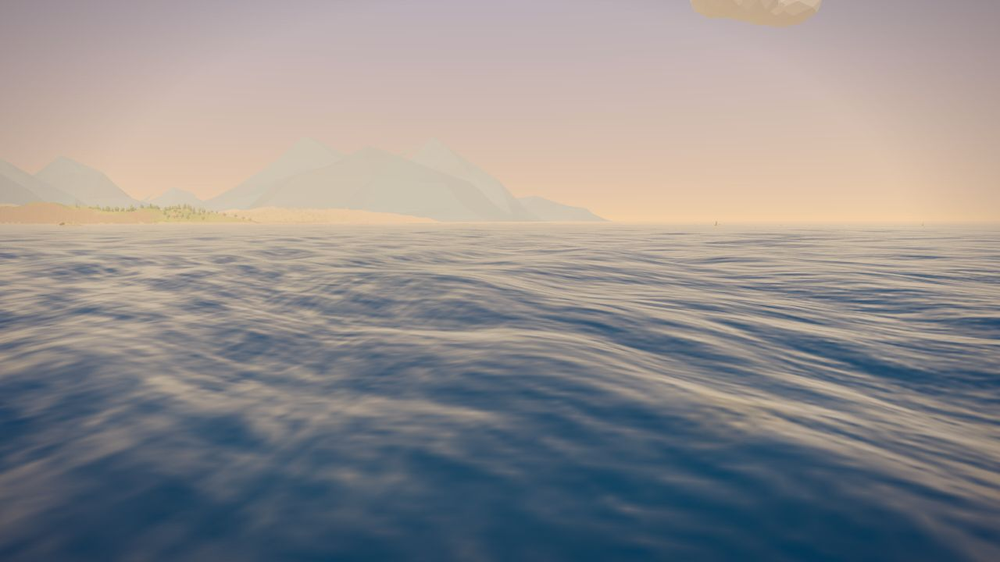
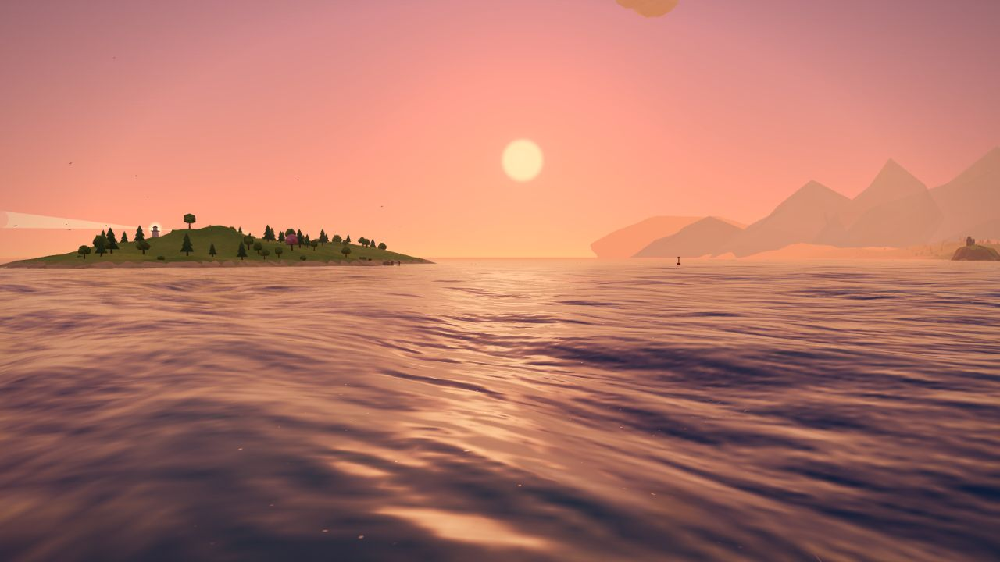
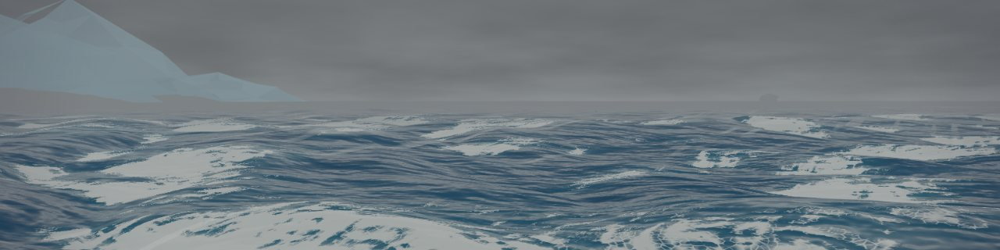
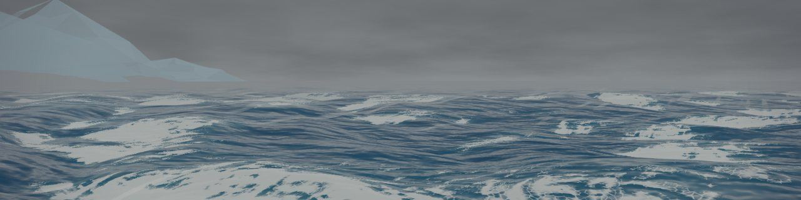
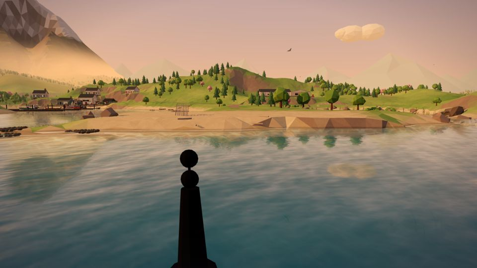
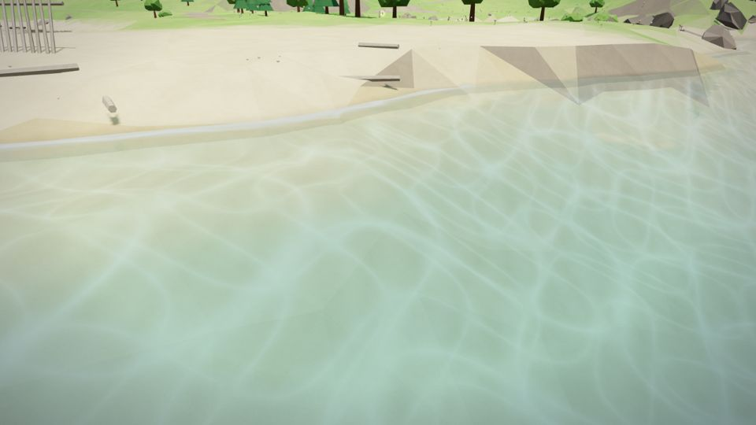
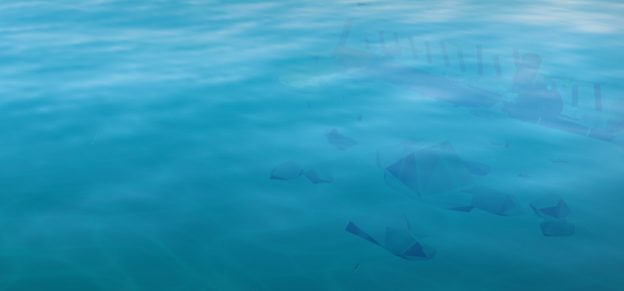

# The sea, close up: an audit and a plan

What the water and the boats on it do now, looked at closely; what the best real-time oceans and
boat models do that they don't yet; and the order to close the gap in, one pull request at a time.
The research behind it is in `docs/water/research-ocean.md` and `docs/water/research-boats.md`,
kept as written, with every source and every licence checked.

## How it was looked at

- **The code:** the surface shader (`src/world/water.js`), the wind sea (`src/world/ocean.js`,
  `oceangpu.js`), wakes and foam (`wakes.js`, `waterfx.js`, `foamTrails.js`), the sky
  (`sky.js`) and the boats' physics (`src/hydro.js`, `src/boat.js`).
- **The game, in a browser:** the open sea photographed close up (Ultra graphics, Ocean: Full) in
  a calm morning, a moderate breeze at noon, a fresh breeze in the afternoon, at dusk and in a storm,
  looking towards the sun, away from it and down. Software rendering, so these say what it looks
  like, not how fast it runs.
- **What the leaders do:** papers, conference talks and open repositories on real-time oceans
  (Bruneton et al. 2010, Dupuy and Bruneton 2012, Horvath 2015, Atlas, Crest, War Thunder, Sea of
  Thieves, Unreal and Unity's water) and on boats in games and naval architecture (Kerner's model
  for Just Cause 3, the MMG manoeuvring method, Savitsky's planing method, drift and roll
  measurements on small craft).

## What it found

**A bug that hid every whitecap.** Whenever the wind was too light for whitecaps (under about
4.5 m/s, as at most starts), the pinch at which the crests break was left at minus infinity, and
every cell of the foam became "not a number". Nothing ever cleared it, so from the first light air
on, no whitecap was drawn again, in a fresh breeze or a gale. It had been so since the FFT ocean
went in. Fixed in W1, below.

**The rest, against the best real-time oceans:**

- **The sun on the water** is one fixed highlight that widens with distance by a rule of thumb, plus
  random sparkles. A real sun path is as wide as the waves too small to draw make it: narrow in a
  calm, a broad glitter in a breeze (Cox and Munk measured it). Far off, the drawn waves shimmer
  rather than averaging into the right roughness.
- **The sky in the water** is a two-colour gradient. Only the planar reflection, where it's on,
  shows clouds and the shore. At sunset the sea doesn't take the sky's colours.
- **How much the water reflects** is a hand-made curve, capped at about 70% at a glancing angle;
  real water's reflectance is 2% looking straight down and climbs to all of it at the horizon.
- **The water's own colour** is a shallow, middle and deep colour mixed by depth, lit as if it were
  a painted surface, and it's seen into by plain transparency. Real water's colour is light coming
  back up out of it, red absorbed first: turquoise over sand, the seabed reddening and then gone.
- **The horizon:** beyond 444 m the sea's surface is drawn without its waves rising and falling
  (only its shading moves), so in a storm the big seas stop at a straight line. The haze is one colour whichever way you look, never warmer towards the sun.
- **The finest waves:** the short-wave layer stops at about 0.4 m. The centimetre ripples that make
  the glitter are only painted noise.
- **Wakes** are worked out, not simulated: they don't bounce off hulls or each other.

**The boats** are already better than most games' (a real panel hull, measured resistance, foils,
ropes, flooding, damage). The hull panels already feel the water's own motion, the waves' orbital
velocity and the current. What the research says is still missing:

- **Added mass:** the water a hull has to move as it heaves, pitches and rolls. Without it, small
  boats bob faster than real ones: by the research's estimate, about one and a half times.
- **The rudder, keel and propeller don't feel the waves' orbital motion**, only the current. So a
  rudder doesn't lose its grip on a crest in a following sea, and a boat doesn't surf.
- **Calibration against measurements:** roll periods and how they damp, drift in the wind (a 4 m
  skiff drifts at about 2.5% of the wind's speed), and the planing trim (Savitsky).
- **The propeller:** thrust falling off with speed, the wash over the rudder, prop walk astern, and
  ventilation that comes and goes rather than on or off.
- **Shallow water:** a boat near the critical speed for the depth (√(gh)) meets more resistance, and
  her wake widens.
- **Anchors:** the rope's catenary, holding by bottom type, and dragging.

## The plan, by what it's worth for what it costs

Each item is its own pull request, checked in the game before and after, with tests that fail
without it.

### The water

| | What | Why it shows | Cost | Sources |
| --- | --- | --- | --- | --- |
| **W1** | **Whitecaps back** (the bug above), and drawn as foam is: a web of bubbles, dense white just broken, thinning to lace as it ages, a turquoise glow of bubbles under it | Every breeze and every gale | None | Dupuy and Bruneton 2012; Monahan's whitecap cover (already used) |
| **W2** | **The sun and the sky on the water, done physically:** Fresnel from water's own 2%, the glitter's width from the slope of the waves too small to draw (Cox–Munk for the wind), the far sea averaging into the right roughness instead of shimmering, and the real sky (sunset colours, overcast) in the reflection on every setting | Every view, most of all towards the sun and at sunset | Low: a few dozen shader operations | Bruneton, Neyret and Holzschuch 2010 (its shader is BSD-3); Cox and Munk 1954 |
| **W3** | **The horizon:** the big seas carried on to it as roughness, haze warmer towards the sun and thinning with height, the sea meeting the sky without a seam | Storms, sunsets, any view out to sea | Negligible | Bruneton 2010; Quílez, "Fog" |
| **W4** | **The water's colour from light in water:** absorption by colour along the view path through the real depth, light scattered back up, the seabed reddening and fading with depth, and (Ocean: Full) the bottom seen through the moving surface, bent by it | Shallows, Las Brasas, the shore | Low; the refraction is medium on phones, so Full only | Unreal's single-layer water; War Thunder (CGDC 2015) |
| **W5** | **The spectrum refined:** spreading that narrows for the longer waves, shallow-water damping, and a third layer of centimetre waves close by (Full only) | The sea's texture close to the boat | Low on the CPU; the third layer is Full only | Horvath 2015; gasgiant/FFT-Ocean (MIT) |
| **W6** | **Spray and spindrift** blown off breaking crests in a gale | Storms | Low | Atlas (GDC 2019) |
| **W7** | **A simulated ripple layer** round the boat: ripples that reflect off hulls and quays and cross each other | Close by, in harbour | Medium; Full only | Crest (SIGGRAPH 2019, MIT) |

### The boats

| | What | What you'd feel | Cost | Sources |
| --- | --- | --- | --- | --- |
| **B1** | **Added mass** in heave, pitch and roll, in the body's mass (as a force it's unstable) | Boats that bob and roll at their real, slower periods | Negligible | Kerner, Part 2 (it was left out of Just Cause 3) |
| **B2** | **The waves' motion at the rudder, keel and propeller**, and wave pressure fading with depth | Surfing down a following sea; the rudder going light on a crest | Some on the panel loop | Arc Blanc (JCGT 2025) |
| **B3** | **Calibration:** roll decay, drift in the wind with a drift sock, and the planing trim checked against Savitsky, each a test | Each boat as her real one | None | De Luca et al. 2024; Allen et al., met.no report 17/2010; OpenPlaning (MIT) |
| **B4** | **The propeller and rudder:** thrust with speed, wash over the rudder, prop walk astern, ventilation with hysteresis | Docking, going astern, a hard turn at speed | Negligible | MMG standard method (Yasukawa and Yoshimura 2015) |
| **B5** | **Shallow water** by depth Froude number: more resistance near the critical speed, the wake widening | Running fast over a shoal | Negligible | Mauro et al., HSMV 2023 |
| **B6** | **Anchors:** catenary, holding by bottom type, setting and dragging | Anchoring in sand, weed or rock | Negligible | Vryhof anchor manual |

## Licences

Code from MIT, BSD or Apache repositories may be reused with its notice; everything here is being
written from the papers instead, so nothing is copied. The repositories that can't be reused in a
paid game are used as ideas only: Unity's BoatAttack and HDRP water (Unity Companion Licence),
Unreal's water (Unreal EULA), anything GPL or AGPL, and anything with no licence (Shadertoy
included). The full table, with each LICENSE file read, is in the two research notes.

## Done

- **W1:** the whitecaps are back, and drawn as foam. Before and after, an
  11 m/s breeze and a storm, the same views:

  | | Before | After |
  | --- | --- | --- |
  | Fresh breeze, 11 m/s |  |  |
  | Storm, 20 m/s |  |  |

  Close up in the fresh breeze: 

- **W2:** the sun and the sky in the water, done physically. The water mirrors the sky as the dome
  draws it (its glow round a low sun, dusk on the far side, a storm's dark), on every setting, not
  a two-colour gradient. How much it reflects is water's own Fresnel, 2% looking straight down and
  rising to nearly all of it at a glancing angle, a rough sea never quite a mirror. The sun's
  reflection is spread by the slopes of the waves too small to draw (Cox and Munk's, wider along
  the wind than across it, less what the drawn waves already show, all of it once a pixel covers
  metres of sea), so the glitter is as wide as the wind makes it; close by it breaks into single
  wavelets flashing. The same views, before and after (the pictures before W2 now taken on a spring
  day, so the morning and the sunset are in daylight):

  | | Before | After |
  | --- | --- | --- |
  | Sunset, 11 m/s |  |  |
  | Calm morning, 1.5 m/s |  |  |

- **B0 (found starting B1):** hulls that meet, solved, not sprung. Adding the boats' added mass
  (B1) turned two tests red: a rowing boat lying across another was kicked off, and a skiff tied
  at a pontoon was flung 18 m from her berth. Both were already there on main, and B1 had only
  moved the start onto them. Two hundred and fifty random overlaps of two hulls on main were
  kicked apart at up to 35 m/s in about a third of them (27 of 100 rows on rows, 34 of 50 skiffs
  on cabin boats), and some shook on for good. Each point touching was a stiff spring with a
  damper of its own: a dozen at once were more than one step could carry, and the spring letting
  go above half a metre a second, with points pushed out opposite sides, kept a boat jumping back
  and forth at ±0.9 m/s for as long as it lasted. And a boat met another as she'd meet a quay: a
  RIB ramming a rowing boat at 15 m/s nudged her off at half a metre a second.

  Now they're worked out as game physics engines work them out (sequential impulses: Catto,
  GDC 2005; Box2D, Bullet): every touching point takes just the push that stops it going in, all
  of them together, a hard knock bouncing her off a little (restitution 0.3); a hull found inside
  another is eased out at half a metre a second; the rub along it is as they move against each
  other, up to its friction. All of her goes out of each hull or quay the one way, by where her
  middle is, kept until it's clearly over. And another boat under her own physics takes her equal
  and opposite share. On the same overlaps: none kicked, all parted at 0.51 m/s; the RIB at
  15 m/s shoves the row off at 15.1 m/s, against 15.2 for two masses meeting.

- **W3:** the horizon, where the sea meets the sky. The haze was one colour for the whole view,
  warmed by turning the camera to face a low sun, so turning warmed all of it at once; and the far
  sea started a step darker than the sky just above it, 12 levels of 255 at dawn and 6 in a storm,
  a line drawn along the horizon. Now the haze is the sky's own colour along the horizon, the way
  each pixel looks, worked out as the sky dome works out its horizon: warm towards a low sun and
  bright round it, dusk-blue on the far side, a storm's dark. The far sea and the far shore fade
  into the sky just above them without a seam; under the water, the haze is the water's, as before.
  Before and after, the horizon in the same views:

  | | Before | After |
  | --- | --- | --- |
  | Calm morning, towards the sun |  |  |
  | Sunset, 11 m/s |  |  |
  | Storm, 20 m/s |  |  |

  Still to do from W3's line in the plan: the big seas carried out past the fine sheet (444 m) as
  roughness. In a storm the waves still end at a line there, now against a haze the sky's colour.

- **B1:** added mass in heave, pitch and roll. Each hull now carries the water she has to move as
  she bobs and pitches: from her waterline beam and waterplane, about one to two times her own
  mass for the light open boats (the rowing boat 1.5, the skiff 1.4, the bass boat 1.8) and less for
  the heavy ones (the cabin boat 0.9, the yacht 0.66); in pitch, that along her length; in roll, a
  sixth more. It's in her mass, not a force, and only as much as she's in the water: off a crest
  she falls at g. On the plane it fades out (from Froude 0.4 to 1), since there she rides a thin
  sheet of water whose push her hull's pressures already carry; carried at full speed it made her
  ride harsher (the RIB's peak jolt 2.6 g to 4.4 g in a fresh sea), which is how that was found.
  Lifted 10 cm and let go in a calm, her heave period before and after:

  | | Rowing | Skiff | Kayak | Bass | Cabin | Console | RIB | Yacht |
  | --- | --- | --- | --- | --- | --- | --- | --- | --- |
  | Before | 0.57 s | 0.60 | 0.47 | 0.70 | 0.87 | 0.90 | 0.70 | 1.30 |
  | After | 0.87 s | 0.90 | 0.67 | 1.07 | 1.17 | 1.27 | 1.00 | 1.70 |

  Driven across an 11 m/s sea, the ride is as it was (vertical jolts at the helm within about 10%
  at every speed); at rest and at a walking pace she bobs at a boat's pace, settling over about
  three swings, not a toy's two.

- **W4 (first part):** the water's colour from light in water. The sea was a see-through layer
  over the seabed, its opacity rising with depth, every colour dimmed alike: the sand in a metre or
  three of water was a flat painted turquoise under a milky veil, and Las Brasas' clear water,
  thinned to show the reef, was a milky wash over pale sand. Now, seen from above, everything under
  the sea (the seabed and its rocks, the fish, a hull below her waterline, a diver) is seen through
  the water as it really is: each colour taken up along the light's way down from the sky and back
  up to the eye (Snell's law for both), red first, and the water's own glow in its place, the more
  water the more of it. This coast's water is coastal (a summer Secchi depth of about ten metres:
  red gone in a couple of metres, blue sooner than green), Las Brasas' clear and blue (25 m and
  more); silt after a blow and a storm's churn take everything faster. The surface itself is what
  it reflects (the sky, the sun's glitter, the foam) and, through the rest, what's under it; only
  where the bottom's too deep to show does the water's own colour stand in for it, so the open sea
  is as it was. Two things that never showed under the old veil came out with it, and are put right:
  sand under the water is wet sand, darker, and the caustics gather light into their bright lines
  from the dimmer patches between (as much light on average) instead of only adding it. Under the
  water, as before. The same views, before and after:

  | | Before | After |
  | --- | --- | --- |
  | A metre or three over sand, noon |  |  |
  | In towards the beach, evening |  |  |
  | The same shallows as clear as Las Brasas' |  |  |
  | Diving, three metres down |  |  |

  Still to do from W4's line in the plan: the bottom seen through the moving surface, bent by it
  (Ocean: Full): done below, W4's second part.

- **B2:** the waves below the surface. A wave's pressure and its orbital motion fade with depth,
  as exp(−k·depth): a short sea's within a metre or two, a long swell's hardly at all over a
  boat's draft. For the sea where she is, two wavenumbers stand for all its waves: one averaged by
  each wave's share of the height, for the pressure, and one by its share of the water's motion,
  for the flow, which leans to the shorter waves (in a fresh breeze about 17 m and 13 m
  wavelengths). Three things follow:
  - **Her hull's pressure follows Smith's correction.** Under a crest the pressure at her keel is
    less than the surface above would say, under a trough more, and deep down it's the still
    water's. A hull held still in a 6 m sea, its crests 10 cm up, now feels this share of the heave force
    she felt before:

    | Rowing | Skiff | Cabin | RIB | Yacht |
    | --- | --- | --- | --- | --- |
    | 0.91 | 0.90 | 0.82 | 0.85 | 0.62 |

    In a 20 m sea, 0.87 to 0.97. In still water, at any tide, nothing changes.
  - **The water's motion round her hull fades the same way:** what drags at her bottom is the
    water moving at its own depth.
  - **Her keel, rudders, centreboard and outboard's leg feel the waves' motion**, not just the
    current. Before, they felt only her own way through the water. On a following sea's crest the
    water runs on with her, so her rudder grips less; in the trough it bites harder. Going ahead
    at 3 m/s on a sea 20 m long, its crests half a metre up, her rudder's grip on the crest is a third of
    what it is in the trough: ((U − u)/(U + u))², u the wave's motion at the rudder's depth. Before,
    the same either way. Lying across a sea, the water's to-and-fro pushes at her keel.

  Running before an 11 m/s sea with the helm amidships, she now yaws as boats do in a following
  sea (yaw rate RMS, main then B2: the RIB 0.015 to 0.019 rad/s, the skiff 0.003 to 0.007, the
  yacht 0.018 to 0.019, her heading wandering 7° where it wandered 6°). Her roll is a little
  gentler (the yacht 3.1° to 2.3° RMS), and the RIB's worst slam into a head sea 4.4 g to 4.3 g.

  Still to do from B2's line in the plan: the propeller. It already feels the waves' rise and
  fall, racing as it comes out on a crest; its push with the speed of the water into it, the
  waves' motion included, comes with B4 (thrust with speed).

- **W4 (second part):** the bottom seen through the moving surface (Ocean: Full). Before, what's
  under the sea was laid under the surface where it was drawn, as if the surface were glass: the
  waves moved over it without moving it. Now, just before the sea is drawn, the picture under it
  (everything solid under the water is drawn by then) is copied off the screen, and each bit of
  the surface shows it where the eye's ray, bent by that bit's slope (Snell's law), meets the
  bottom, rather than straight below. Only the waves' share of the bend: a level surface shows it
  where it was, so nothing changes in a calm but what moves it. The bend is a quarter of the depth
  times the slope (2 m down under a slope of 0.1, about 5 cm), as the test checks against Snell's
  law worked out by angles. The waves drawn are only part of the sea's roughness: the rest, too
  fine to draw (what spreads the sun's glitter, W2), bends it too, each wavelet its own way. Close
  by, where a pixel sees them one at a time, that's a shimmer of the right size moving with them;
  further off, where a pixel covers many, their average, a blur. A few metres down at most
  (deeper, the water's own colour hides it), and none at the very edge of the beach. The sand and
  its caustics waver as the ripples pass, and the wreck and the rocks under the buoy are bent by
  the surface instead of painted under it:

  | | Before | After |
  | --- | --- | --- |
  | The shallows as clear as Las Brasas', noon |  |  |
  | The wreck under its buoy, a breeze |  |  |

  It shows most in motion. In a still in software rendering, about one pixel in a hundred changes
  by more than a shade in the clear shallows and over the wreck, and fewer than one in a thousand
  looking in to the beach; what changes is the caustics' lines and the wreck's edges going wavy. It
  costs one copy of the screen a frame and a few more texture reads for each pixel of near sea, on
  Ocean: Full only.

- **B3:** calibration against measurements, first part: the wind on a boat, a boat drifting, a
  boat at anchor, and her roll. Before, the wind pushed on a boat the same whichever way she lay
  (0.003 N per kilogram of her for each (m/s)² of wind), several times what air does on a hull
  that size, so every boat left to drift went off at 4 to 14% of the wind, lying end-on to it.
  Field trials of small craft drifting (Allen et al., met.no report 17/2010) find 3 to 5%.

  Now the wind on her topsides is Blendermann's (1994), as fitted to wind-tunnel tests of ships
  and boats (and as Fossen's *Handbook of Marine Craft Hydrodynamics*, 2011, gives it), with his
  coefficients for a speed boat: across her on the area of her side, along her on the area of her
  end, in the wind as it blows at her windage's height over open water (U₁₀·(z/10)^0.12, DNV's
  marine profile). Each boat has her own side area, end share and height (hull, cabin or console,
  whoever's at the helm). Across her the push grows with the sine of the wind's angle off her
  bow, as a wing's lift does, so lying to the wind she's pushed back to it; and it pushes further
  forward the finer the wind is on her bow (a flat plate's quarter-chord), so at anchor she sheers
  as boats do. Drifting slowly with nothing driving her, her resistance is the water's on her own
  panels (mostly friction along them) rather than her full resistance curve, which is several
  times a real hull's at a walking pace so that she answers the helm and stops when it's off; and
  the slow, linear part of the water's grip on her panels comes in across her only as she gets
  under way (a hull drifting slowly across the water makes no waves).

  Her drift through the water down the wind, after a minute to settle, over two minutes (the
  wind's own sea, no swell; the wind she feels on average, its gusts and all, in brackets):

  | Wind | Field trials, 4.15 m skiff | Skiff, before | Skiff, now | Rowing boat | Console | Yacht |
  | --- | --- | --- | --- | --- | --- | --- |
  | 5 m/s | 0.26 to 0.29 m/s | 0.34 (6.0) | 0.28 (6.1) | 0.19, was 0.23 | 0.29, was 0.44 | 0.21, was 0.42 |
  | 10 m/s | 0.39 to 0.43 | 0.77 (9.9) | 0.38 (11.7) | 0.39, was 0.60 | 0.46, was 1.18 | 0.42, was 1.14 |
  | 15 m/s | 0.51 to 0.55 | 1.50 (15.5) | 0.46 (16.6) | 0.46, was 1.17 | 0.52, was 2.18 | 0.48, was 2.13 |

  (The trials' fit, 0.0252·U₁₀ + 0.134 m/s, at the game's wind and at the wind she feels.) At 5
  and 10 m/s the skiff is within 4 and 12% of the fit at the wind she feels; at 15 m/s, a wind
  above most of the trials', 16% under it.

  **At anchor.** On her rope she lies near head to it on average and swings to and fro about it:
  in a moderate breeze the rowing boat swings through about 60° of compass each half-minute, the
  fleet 23 to 94° (the yacht least, the skiff and rowing boat most in a fresh wind). Practical
  Sailor's survey of sailors at anchor in strong weather: most see 55 to 65°, some up to 120°.

  What drags an anchor is now mostly the sea, not the wind. Through a gale (17 m/s, the sea it
  raises) the ordinary anchor held each boat tried (rowing boat, skiff, bass boat, console). In the game's own storm (its wind at its strongest,
  gusting to over 30 m/s, and its long seas built), over three minutes on the rope, the rowing
  boat's ordinary anchor dragged 2.6 m and the skiff's 2.5 m (the console's 0.9 m); the heavier
  one on chain held each of them (0.14 m at most). Before, with the wind's push overstated, an
  ordinary anchor dragged far faster (in the game's storm the console's went 25 m in a minute and a
  half) and even the heavier one dragged (1.4 m). What an anchor holds is unchanged (12% of her weight, the heavier one 2.2 times
  that): a well-set anchor in good sand. Holding by the bottom (sand, weed, mud, rock) is B6's.

  **Spot-Lock** holds her to its GPS fix, and a consumer fix with satellite-based correction is
  good to a metre or two, its error wandering over tens of seconds (modelled so: 0.6 m each way,
  half a minute). In a flat calm she wanders up to about 1.3 m round her spot, the motor always
  correcting; in a 7 m/s breeze it keeps her within about a metre. In a gale's sea her bow lifts
  and its propeller draws air (as before), and she drags off.

  **Her roll**, heeled 10° in a calm and let go (a free roll decay): damping ratios 0.039 (the
  yacht) to 0.083 (the sailing boat), periods 1.2 to 3.4 s, as before B3 (it changes how she's
  pushed across the water, not how she rolls). Calm-water decay tests of small craft find a few
  hundredths to a tenth (a 10 m yacht's: 0.025 with her sails stowed, 0.079 with her mainsail up).
  A test now keeps it there.

  The engines' top speeds were measured again (tools/engine-trials.mjs): with less air holding
  her back, each is 0.2 to 2.1% faster; and a propeller of less pitch is now at least an inch
  less than her matched one (they come in whole inches).

  Still to do from B3's line in the plan: the planing trim checked against Savitsky.

- **B4:** the propeller. Three things it does that it didn't:

  **It walks.** A propeller pushes a little sideways as well as ahead, its blades biting deeper
  water at the bottom of their sweep than at the top: a right-handed one (as most outboards' are)
  walks her stern to port going astern, and a little to starboard going ahead, most from rest.
  Seamanship texts give its direction and when it's worst but not how much; here, 8% of a real
  propeller's push astern and 2% ahead (the game's push is bigger than a real one's, so it's
  scaled as the propeller's turning arm already is), less as she gathers way. On these small
  outboards it's small, as it is on real ones: easing astern from rest for ten seconds, helm
  amidships, the skiff's bow swings 1.0° further to starboard than without it, the cabin boat's
  1.4°, the bass boat's and the RIB's 0.6 and 0.7°. The console's two outboards and the yacht's
  two screws turn opposite ways and cancel it (their headings the same within 0.1 and 0.4°).

  **It draws air, and keeps it.** Driven hard as part of its disc breaks the surface, a propeller
  draws air down onto its blades and loses most of its push (70% here), the engine racing. Model
  tests find it has a memory (Koushan; Kozlowska et al.): the air takes a moment to get down, and
  once there it stays until the propeller's well under again or eased, its push coming back as
  the air washes out. Here the air's down within about a third of a second, stays while the
  propeller's no deeper than 1.4 times what it needs to grip, and washes out over a second or so
  once it's deeper or eased. Flat out into a lively sea (11 m/s), the RIB's propeller now has its air down
  1.1% of the time, leaving a crest, and she averages 11.62 m/s where she made 11.80; before
  the sea, and the console and the skiff either way, it never comes up enough to.

  **It feels the waves' motion (B2's leftover).** The water into it is her way through the water
  less the waves' own motion along her at the propeller's depth: up to 0.36 m/s either way in a
  1.8 m swell. Running down a sea's face the water's going her way, so near her top speed her
  propeller reaches its limiter sooner; climbing one, later.

  Still to do from B4's line in the plan: the rudder's wash was already in (a propeller's
  slipstream over the leg or the rudder behind it steers her at idle); the propeller's push
  falling away with her speed (rather than holding until its limiter) would change every boat's
  acceleration and is left for a pass that measures it against real acceleration trials.

- **B5:** shallow water, by her depth Froude number Fh = V/√(g·h): her speed against the speed the
  bottom lets her waves go.

  **Her resistance.** In water h deep, a hull makes the resistance she would in deep water at a
  higher speed: Lackenby's (1963) fit to Schlichting's method, which the ITTC's speed-trial
  procedure uses to correct for shallow water. Part of it is the water squeezed back past her
  (her midship section against the depth squared), most of it her waves slowed by the bottom as
  Fh nears one. Its home is below that critical speed; past it her transverse waves can't keep up
  and the hump is behind her, so it fades out between Fh 1 and 1.3. Two bounds of ours: the extra
  is held to half as much again as her deep-water resistance (model tests and computations of
  planing hulls put the worst of it about the critical speed, but none we could reach said how
  much), and since what the bottom changes is the waves she makes, it's hers in full up to a
  length Froude number of 0.8 and a quarter of it once she's planing (from 1.6).

  So a boat on a moderate push over a shoal is held back about the critical speed, and pushed
  hard she's slowed through it and out the other side. A RIB under a steady push from rest over a
  flat bottom (in the physics alone):

  | Push | Deep water | Over 4 m (critical 6.3 m/s) | Over 2 m (4.4 m/s) | Over 1.2 m (3.4 m/s) |
  | --- | --- | --- | --- | --- |
  | Moderate: after 40 s | 5.92 m/s | 5.34 | 4.64 | 5.92 (through it) |
  | Hard: time to 8 m/s | 1.8 s | 2.5 s, then on as in deep water | 1.8 s | 1.8 s |

  **Her wake.** In shallow water the wedge opens out: Havelock's (1908) result, worked out for
  each depth Froude number from the waves that keep pace with her on the finite-depth dispersion
  relation and the widest of their energy's paths. Kelvin's 19.5° up to Fh 0.6, 24° at 0.8, 35°
  at 0.9, 46° at 0.95, square across her track at the critical speed (held to 77° here, where it's
  singular); past it no wave can keep up across her track, so the transverse waves are gone and
  the wedge closes to her Mach angle, asin(1/Fh): 65° at 1.1, 50° at 1.3, 30° at 2. Each point of
  her track remembers the depth she made it in, and the deep-water pattern is stretched out to
  the wider wedge, in the physics (the wakes that rock other boats) and in the drawn wake alike.

  **The engines' trials** now run where the bottom can't touch them, on a calm day made calm: well
  out to sea in 60 to 100 m of water (the ITTC asks speed trials for more than 2.75·V²/g of water,
  about 60 m at 15 m/s), where the old course south of the bay had 17 to 27 m, which a fast boat's
  waves feel; and with no wind, swell or chop, where before they took whatever swell the default
  weather left, which the bay partly sheltered. Measured again there, each engine's top speed is
  between 1.1% slower (the skiff's electric) and 2.6% faster than before.

