# The sea, close up: an audit and a plan

What the water and the boats on it do now, looked at closely; what the best real-time oceans and
boat models do that they don't yet; and the order to close the gap in, one pull request at a time.
The research behind it is in `docs/water/research-ocean.md` and `docs/water/research-boats.md`,
kept as written, with every source and every licence checked.

## How it was looked at

- **The code:** the surface shader (`src/world/water.js`), the wind sea (`src/world/ocean.js`,
  `oceangpu.js`), wakes and foam (`wakes.js`, `waterfx.js`, `foamTrails.js`), the sky
  (`sky.js`) and the boats' physics (`src/hydro.js`, `src/boat.js`).
- **The game, in a browser:** the open sea photographed close up (Ultra graphics, Ocean: Full) in
  a calm morning, a moderate breeze at noon, a fresh breeze in the afternoon, at dusk and in a storm,
  looking towards the sun, away from it and down. Software rendering, so these say what it looks
  like, not how fast it runs.
- **What the leaders do:** papers, conference talks and open repositories on real-time oceans
  (Bruneton et al. 2010, Dupuy and Bruneton 2012, Horvath 2015, Atlas, Crest, War Thunder, Sea of
  Thieves, Unreal and Unity's water) and on boats in games and naval architecture (Kerner's model
  for Just Cause 3, the MMG manoeuvring method, Savitsky's planing method, drift and roll
  measurements on small craft).

## What it found

**A bug that hid every whitecap.** Whenever the wind was too light for whitecaps (under about
4.5 m/s, as at most starts), the pinch at which the crests break was left at minus infinity, and
every cell of the foam became "not a number". Nothing ever cleared it, so from the first light air
on, no whitecap was drawn again, in a fresh breeze or a gale. It had been so since the FFT ocean
went in. Fixed in W1, below.

**The rest, against the best real-time oceans:**

- **The sun on the water** is one fixed highlight that widens with distance by a rule of thumb, plus
  random sparkles. A real sun path is as wide as the waves too small to draw make it: narrow in a
  calm, a broad glitter in a breeze (Cox and Munk measured it). Far off, the drawn waves shimmer
  rather than averaging into the right roughness.
- **The sky in the water** is a two-colour gradient. Only the planar reflection, where it's on,
  shows clouds and the shore. At sunset the sea doesn't take the sky's colours.
- **How much the water reflects** is a hand-made curve, capped at about 70% at a glancing angle;
  real water's reflectance is 2% looking straight down and climbs to all of it at the horizon.
- **The water's own colour** is a shallow, middle and deep colour mixed by depth, lit as if it were
  a painted surface, and it's seen into by plain transparency. Real water's colour is light coming
  back up out of it, red absorbed first: turquoise over sand, the seabed reddening and then gone.
- **The horizon:** beyond 444 m the sea's surface is drawn without its waves rising and falling
  (only its shading moves), so in a storm the big seas stop at a straight line. The haze is one colour whichever way you look, never warmer towards the sun.
- **The finest waves:** the short-wave layer stops at about 0.4 m. The centimetre ripples that make
  the glitter are only painted noise.
- **Wakes** are worked out, not simulated: they don't bounce off hulls or each other.

**The boats** are already better than most games' (a real panel hull, measured resistance, foils,
ropes, flooding, damage). The hull panels already feel the water's own motion, the waves' orbital
velocity and the current. What the research says is still missing:

- **Added mass:** the water a hull has to move as it heaves, pitches and rolls. Without it, small
  boats bob faster than real ones: by the research's estimate, about one and a half times.
- **The rudder, keel and propeller don't feel the waves' orbital motion**, only the current. So a
  rudder doesn't lose its grip on a crest in a following sea, and a boat doesn't surf.
- **Calibration against measurements:** roll periods and how they damp, drift in the wind (a 4 m
  skiff drifts at about 2.5% of the wind's speed), and the planing trim (Savitsky).
- **The propeller:** thrust falling off with speed, the wash over the rudder, prop walk astern, and
  ventilation that comes and goes rather than on or off.
- **Shallow water:** a boat near the critical speed for the depth (√(gh)) meets more resistance, and
  her wake widens.
- **Anchors:** the rope's catenary, holding by bottom type, and dragging.

## The plan, by what it's worth for what it costs

Each item is its own pull request, checked in the game before and after, with tests that fail
without it.

### The water

| | What | Why it shows | Cost | Sources |
| --- | --- | --- | --- | --- |
| **W1** | **Whitecaps back** (the bug above), and drawn as foam is: a web of bubbles, dense white just broken, thinning to lace as it ages, a turquoise glow of bubbles under it | Every breeze and every gale | None | Dupuy and Bruneton 2012; Monahan's whitecap cover (already used) |
| **W2** | **The sun and the sky on the water, done physically:** Fresnel from water's own 2%, the glitter's width from the slope of the waves too small to draw (Cox–Munk for the wind), the far sea averaging into the right roughness instead of shimmering, and the real sky (sunset colours, overcast) in the reflection on every setting | Every view, most of all towards the sun and at sunset | Low: a few dozen shader operations | Bruneton, Neyret and Holzschuch 2010 (its shader is BSD-3); Cox and Munk 1954 |
| **W3** | **The horizon:** the big seas carried on to it as roughness, haze warmer towards the sun and thinning with height, the sea meeting the sky without a seam | Storms, sunsets, any view out to sea | Negligible | Bruneton 2010; Quílez, "Fog" |
| **W4** | **The water's colour from light in water:** absorption by colour along the view path through the real depth, light scattered back up, the seabed reddening and fading with depth, and (Ocean: Full) the bottom seen through the moving surface, bent by it | Shallows, Las Brasas, the shore | Low; the refraction is medium on phones, so Full only | Unreal's single-layer water; War Thunder (CGDC 2015) |
| **W5** | **The spectrum refined:** spreading that narrows for the longer waves, shallow-water damping, and a third layer of centimetre waves close by (Full only) | The sea's texture close to the boat | Low on the CPU; the third layer is Full only | Horvath 2015; gasgiant/FFT-Ocean (MIT) |
| **W6** | **Spray and spindrift** blown off breaking crests in a gale | Storms | Low | Atlas (GDC 2019) |
| **W7** | **A simulated ripple layer** round the boat: ripples that reflect off hulls and quays and cross each other | Close by, in harbour | Medium; Full only | Crest (SIGGRAPH 2019, MIT) |

### The boats

| | What | What you'd feel | Cost | Sources |
| --- | --- | --- | --- | --- |
| **B1** | **Added mass** in heave, pitch and roll, in the body's mass (as a force it's unstable) | Boats that bob and roll at their real, slower periods | Negligible | Kerner, Part 2 (it was left out of Just Cause 3) |
| **B2** | **The waves' motion at the rudder, keel and propeller**, and wave pressure fading with depth | Surfing down a following sea; the rudder going light on a crest | Some on the panel loop | Arc Blanc (JCGT 2025) |
| **B3** | **Calibration:** roll decay, drift in the wind with a drift sock, and the planing trim checked against Savitsky, each a test | Each boat as her real one | None | De Luca et al. 2024; Allen et al., met.no report 17/2010; OpenPlaning (MIT) |
| **B4** | **The propeller and rudder:** thrust with speed, wash over the rudder, prop walk astern, ventilation with hysteresis | Docking, going astern, a hard turn at speed | Negligible | MMG standard method (Yasukawa and Yoshimura 2015) |
| **B5** | **Shallow water** by depth Froude number: more resistance near the critical speed, the wake widening | Running fast over a shoal | Negligible | Mauro et al., HSMV 2023 |
| **B6** | **Anchors:** catenary, holding by bottom type, setting and dragging | Anchoring in sand, weed or rock | Negligible | The elastic catenary (Irvine 1981; Faltinsen); Pat Piper's scope table and the US Sailing anchor study; NCEL on drag anchors (the Vryhof manual, planned, was on a blocked host) |

## Licences

Code from MIT, BSD or Apache repositories may be reused with its notice; everything here is being
written from the papers instead, so nothing is copied. The repositories that can't be reused in a
paid game are used as ideas only: Unity's BoatAttack and HDRP water (Unity Companion Licence),
Unreal's water (Unreal EULA), anything GPL or AGPL, and anything with no licence (Shadertoy
included). The full table, with each LICENSE file read, is in the two research notes.

## Done

- **W1:** the whitecaps are back, and drawn as foam. Before and after, an
  11 m/s breeze and a storm, the same views:

  | | Before | After |
  | --- | --- | --- |
  | Fresh breeze, 11 m/s |  |  |
  | Storm, 20 m/s | 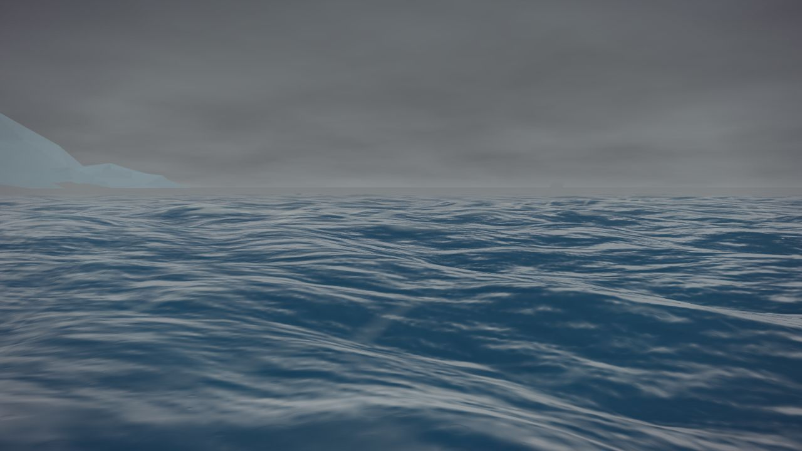 | 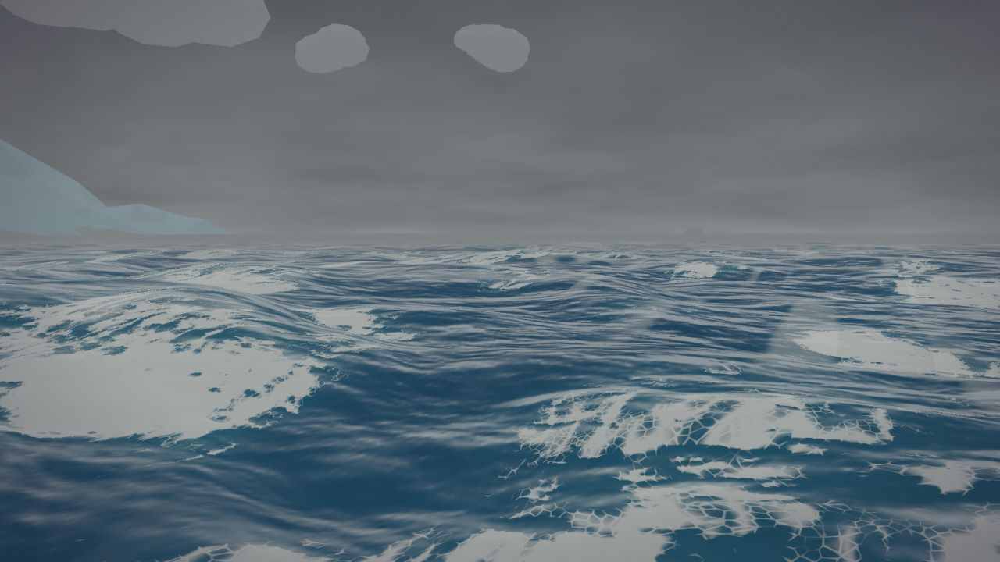 |

  Close up in the fresh breeze: 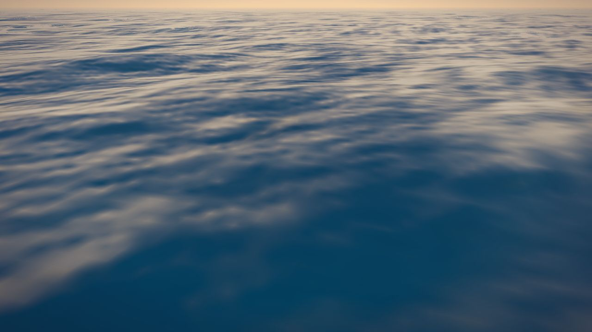

- **W2:** the sun and the sky in the water, done physically. The water mirrors the sky as the dome
  draws it (its glow round a low sun, dusk on the far side, a storm's dark), on every setting, not
  a two-colour gradient. How much it reflects is water's own Fresnel, 2% looking straight down and
  rising to nearly all of it at a glancing angle, a rough sea never quite a mirror. The sun's
  reflection is spread by the slopes of the waves too small to draw (Cox and Munk's, wider along
  the wind than across it, less what the drawn waves already show, all of it once a pixel covers
  metres of sea), so the glitter is as wide as the wind makes it; close by it breaks into single
  wavelets flashing. The same views, before and after (the pictures before W2 now taken on a spring
  day, so the morning and the sunset are in daylight):

  | | Before | After |
  | --- | --- | --- |
  | Sunset, 11 m/s |  |  |
  | Calm morning, 1.5 m/s | 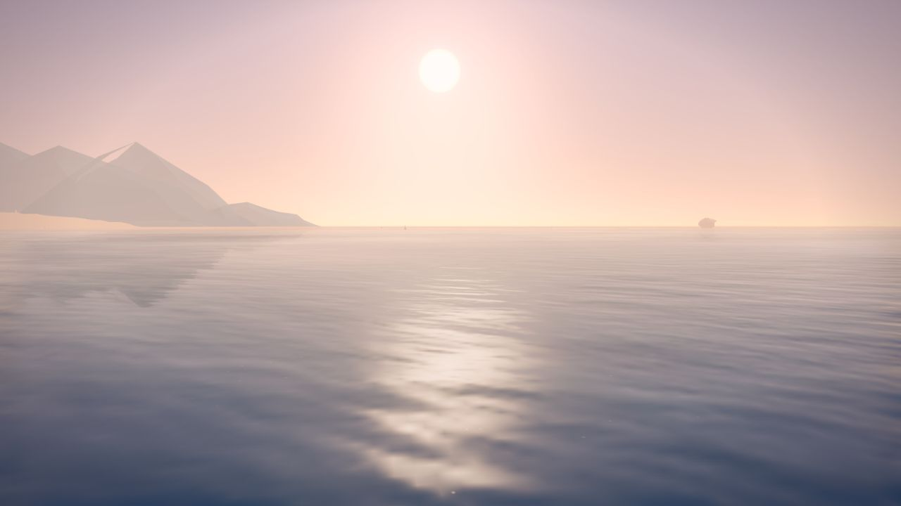 |  |

- **B0 (found starting B1):** hulls that meet, solved, not sprung. Adding the boats' added mass
  (B1) turned two tests red: a rowing boat lying across another was kicked off, and a skiff tied
  at a pontoon was flung 18 m from her berth. Both were already there on main, and B1 had only
  moved the start onto them. Two hundred and fifty random overlaps of two hulls on main were
  kicked apart at up to 35 m/s in about a third of them (27 of 100 rows on rows, 34 of 50 skiffs
  on cabin boats), and some shook on for good. Each point touching was a stiff spring with a
  damper of its own: a dozen at once were more than one step could carry, and the spring letting
  go above half a metre a second, with points pushed out opposite sides, kept a boat jumping back
  and forth at ±0.9 m/s for as long as it lasted. And a boat met another as she'd meet a quay: a
  RIB ramming a rowing boat at 15 m/s nudged her off at half a metre a second.

  Now they're worked out as game physics engines work them out (sequential impulses: Catto,
  GDC 2005; Box2D, Bullet): every touching point takes just the push that stops it going in, all
  of them together, a hard knock bouncing her off a little (restitution 0.3); a hull found inside
  another is eased out at half a metre a second; the rub along it is as they move against each
  other, up to its friction. All of her goes out of each hull or quay the one way, by where her
  middle is, kept until it's clearly over. And another boat under her own physics takes her equal
  and opposite share. On the same overlaps: none kicked, all parted at 0.51 m/s; the RIB at
  15 m/s shoves the row off at 15.1 m/s, against 15.2 for two masses meeting.

- **W3:** the horizon, where the sea meets the sky. The haze was one colour for the whole view,
  warmed by turning the camera to face a low sun, so turning warmed all of it at once; and the far
  sea started a step darker than the sky just above it, 12 levels of 255 at dawn and 6 in a storm,
  a line drawn along the horizon. Now the haze is the sky's own colour along the horizon, the way
  each pixel looks, worked out as the sky dome works out its horizon: warm towards a low sun and
  bright round it, dusk-blue on the far side, a storm's dark. The far sea and the far shore fade
  into the sky just above them without a seam; under the water, the haze is the water's, as before.
  Before and after, the horizon in the same views:

  | | Before | After |
  | --- | --- | --- |
  | Calm morning, towards the sun |  |  |
  | Sunset, 11 m/s |  |  |
  | Storm, 20 m/s |  |  |

  Still to do from W3's line in the plan: the big seas carried out past the fine sheet (444 m) as
  roughness. In a storm the waves still end at a line there, now against a haze the sky's colour.

- **B1:** added mass in heave, pitch and roll. Each hull now carries the water she has to move as
  she bobs and pitches: from her waterline beam and waterplane, about one to two times her own
  mass for the light open boats (the rowing boat 1.5, the skiff 1.4, the bass boat 1.8) and less for
  the heavy ones (the cabin boat 0.9, the yacht 0.66); in pitch, that along her length; in roll, a
  sixth more. It's in her mass, not a force, and only as much as she's in the water: off a crest
  she falls at g. On the plane it fades out (from Froude 0.4 to 1), since there she rides a thin
  sheet of water whose push her hull's pressures already carry; carried at full speed it made her
  ride harsher (the RIB's peak jolt 2.6 g to 4.4 g in a fresh sea), which is how that was found.
  Lifted 10 cm and let go in a calm, her heave period before and after:

  | | Rowing | Skiff | Kayak | Bass | Cabin | Console | RIB | Yacht |
  | --- | --- | --- | --- | --- | --- | --- | --- | --- |
  | Before | 0.57 s | 0.60 | 0.47 | 0.70 | 0.87 | 0.90 | 0.70 | 1.30 |
  | After | 0.87 s | 0.90 | 0.67 | 1.07 | 1.17 | 1.27 | 1.00 | 1.70 |

  Driven across an 11 m/s sea, the ride is as it was (vertical jolts at the helm within about 10%
  at every speed); at rest and at a walking pace she bobs at a boat's pace, settling over about
  three swings, not a toy's two.

- **W4 (first part):** the water's colour from light in water. The sea was a see-through layer
  over the seabed, its opacity rising with depth, every colour dimmed alike: the sand in a metre or
  three of water was a flat painted turquoise under a milky veil, and Las Brasas' clear water,
  thinned to show the reef, was a milky wash over pale sand. Now, seen from above, everything under
  the sea (the seabed and its rocks, the fish, a hull below her waterline, a diver) is seen through
  the water as it really is: each colour taken up along the light's way down from the sky and back
  up to the eye (Snell's law for both), red first, and the water's own glow in its place, the more
  water the more of it. This coast's water is coastal (a summer Secchi depth of about ten metres:
  red gone in a couple of metres, blue sooner than green), Las Brasas' clear and blue (25 m and
  more); silt after a blow and a storm's churn take everything faster. The surface itself is what
  it reflects (the sky, the sun's glitter, the foam) and, through the rest, what's under it; only
  where the bottom's too deep to show does the water's own colour stand in for it, so the open sea
  is as it was. Two things that never showed under the old veil came out with it, and are put right:
  sand under the water is wet sand, darker, and the caustics gather light into their bright lines
  from the dimmer patches between (as much light on average) instead of only adding it. Under the
  water, as before. The same views, before and after:

  | | Before | After |
  | --- | --- | --- |
  | A metre or three over sand, noon | 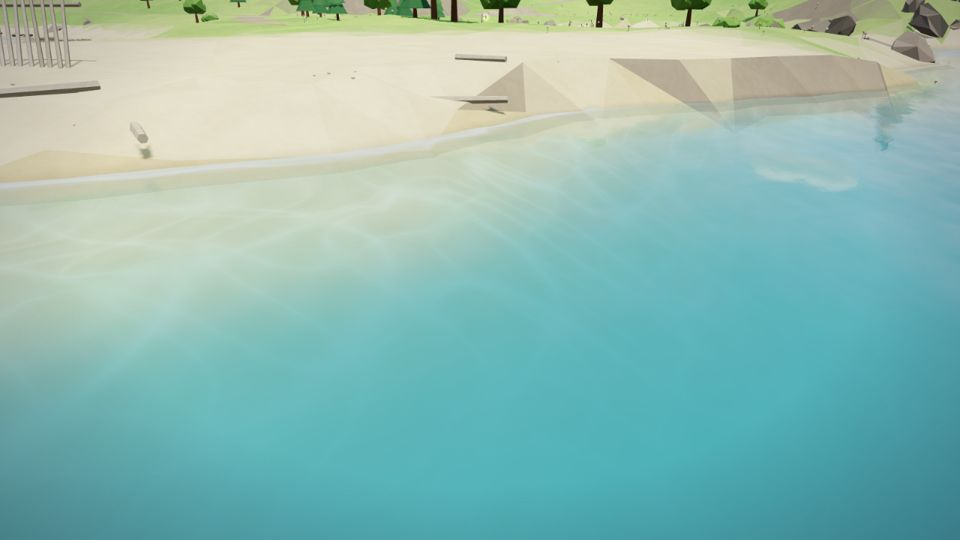 |  |
  | In towards the beach, evening |  | 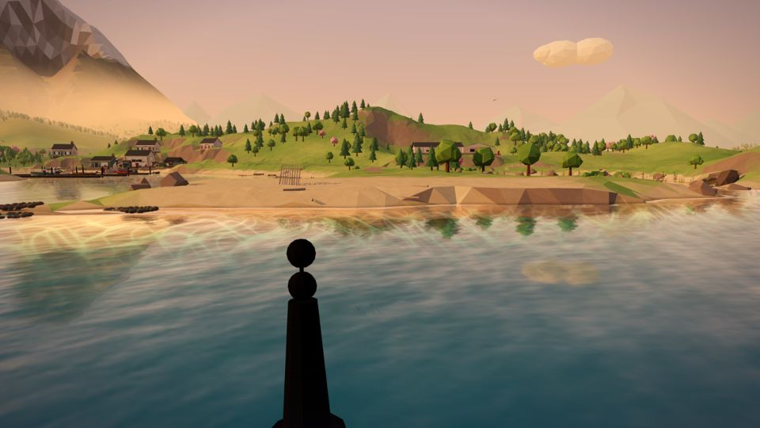 |
  | The same shallows as clear as Las Brasas' |  |  |
  | Diving, three metres down | 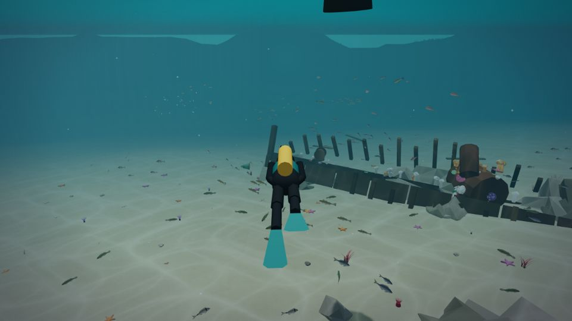 | 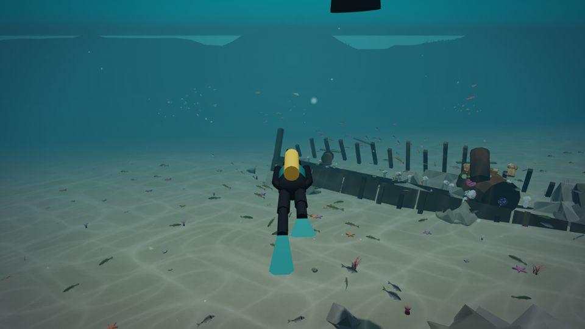 |

  Still to do from W4's line in the plan: the bottom seen through the moving surface, bent by it
  (Ocean: Full): done below, W4's second part.

- **B2:** the waves below the surface. A wave's pressure and its orbital motion fade with depth,
  as exp(−k·depth): a short sea's within a metre or two, a long swell's hardly at all over a
  boat's draft. For the sea where she is, two wavenumbers stand for all its waves: one averaged by
  each wave's share of the height, for the pressure, and one by its share of the water's motion,
  for the flow, which leans to the shorter waves (in a fresh breeze about 17 m and 13 m
  wavelengths). Three things follow:
  - **Her hull's pressure follows Smith's correction.** Under a crest the pressure at her keel is
    less than the surface above would say, under a trough more, and deep down it's the still
    water's. A hull held still in a 6 m sea, its crests 10 cm up, now feels this share of the heave force
    she felt before:

    | Rowing | Skiff | Cabin | RIB | Yacht |
    | --- | --- | --- | --- | --- |
    | 0.91 | 0.90 | 0.82 | 0.85 | 0.62 |

    In a 20 m sea, 0.87 to 0.97. In still water, at any tide, nothing changes.
  - **The water's motion round her hull fades the same way:** what drags at her bottom is the
    water moving at its own depth.
  - **Her keel, rudders, centreboard and outboard's leg feel the waves' motion**, not just the
    current. Before, they felt only her own way through the water. On a following sea's crest the
    water runs on with her, so her rudder grips less; in the trough it bites harder. Going ahead
    at 3 m/s on a sea 20 m long, its crests half a metre up, her rudder's grip on the crest is a third of
    what it is in the trough: ((U − u)/(U + u))², u the wave's motion at the rudder's depth. Before,
    the same either way. Lying across a sea, the water's to-and-fro pushes at her keel.

  Running before an 11 m/s sea with the helm amidships, she now yaws as boats do in a following
  sea (yaw rate RMS, main then B2: the RIB 0.015 to 0.019 rad/s, the skiff 0.003 to 0.007, the
  yacht 0.018 to 0.019, her heading wandering 7° where it wandered 6°). Her roll is a little
  gentler (the yacht 3.1° to 2.3° RMS), and the RIB's worst slam into a head sea 4.4 g to 4.3 g.

  Still to do from B2's line in the plan: the propeller. It already feels the waves' rise and
  fall, racing as it comes out on a crest; its push with the speed of the water into it, the
  waves' motion included, comes with B4 (thrust with speed).

- **W4 (second part):** the bottom seen through the moving surface (Ocean: Full). Before, what's
  under the sea was laid under the surface where it was drawn, as if the surface were glass: the
  waves moved over it without moving it. Now, just before the sea is drawn, the picture under it
  (everything solid under the water is drawn by then) is copied off the screen, and each bit of
  the surface shows it where the eye's ray, bent by that bit's slope (Snell's law), meets the
  bottom, rather than straight below. Only the waves' share of the bend: a level surface shows it
  where it was, so nothing changes in a calm but what moves it. The bend is a quarter of the depth
  times the slope (2 m down under a slope of 0.1, about 5 cm), as the test checks against Snell's
  law worked out by angles. The waves drawn are only part of the sea's roughness: the rest, too
  fine to draw (what spreads the sun's glitter, W2), bends it too, each wavelet its own way. Close
  by, where a pixel sees them one at a time, that's a shimmer of the right size moving with them;
  further off, where a pixel covers many, their average, a blur. A few metres down at most
  (deeper, the water's own colour hides it), and none at the very edge of the beach. The sand and
  its caustics waver as the ripples pass, and the wreck and the rocks under the buoy are bent by
  the surface instead of painted under it:

  | | Before | After |
  | --- | --- | --- |
  | The shallows as clear as Las Brasas', noon |  | 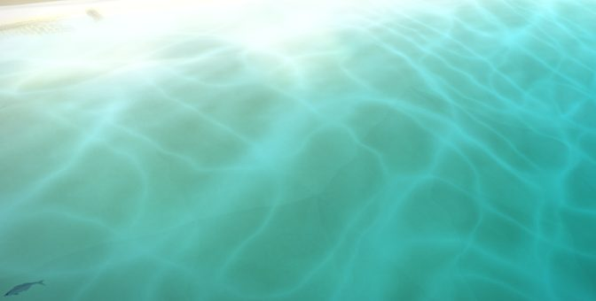 |
  | The wreck under its buoy, a breeze |  | 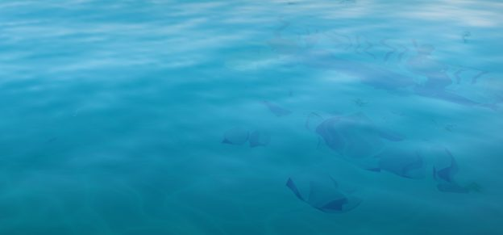 |

  It shows most in motion. In a still in software rendering, about one pixel in a hundred changes
  by more than a shade in the clear shallows and over the wreck, and fewer than one in a thousand
  looking in to the beach; what changes is the caustics' lines and the wreck's edges going wavy. It
  costs one copy of the screen a frame and a few more texture reads for each pixel of near sea, on
  Ocean: Full only.

- **B3:** calibration against measurements, first part: the wind on a boat, a boat drifting, a
  boat at anchor, and her roll. Before, the wind pushed on a boat the same whichever way she lay
  (0.003 N per kilogram of her for each (m/s)² of wind), several times what air does on a hull
  that size, so every boat left to drift went off at 4 to 14% of the wind, lying end-on to it.
  Field trials of small craft drifting (Allen et al., met.no report 17/2010) find 3 to 5%.

  Now the wind on her topsides is Blendermann's (1994), as fitted to wind-tunnel tests of ships
  and boats (and as Fossen's *Handbook of Marine Craft Hydrodynamics*, 2011, gives it), with his
  coefficients for a speed boat: across her on the area of her side, along her on the area of her
  end, in the wind as it blows at her windage's height over open water (U₁₀·(z/10)^0.12, DNV's
  marine profile). Each boat has her own side area, end share and height (hull, cabin or console,
  whoever's at the helm). Across her the push grows with the sine of the wind's angle off her
  bow, as a wing's lift does, so lying to the wind she's pushed back to it; and it pushes further
  forward the finer the wind is on her bow (a flat plate's quarter-chord), so at anchor she sheers
  as boats do. Drifting slowly with nothing driving her, her resistance is the water's on her own
  panels (mostly friction along them) rather than her full resistance curve, which is several
  times a real hull's at a walking pace so that she answers the helm and stops when it's off; and
  the slow, linear part of the water's grip on her panels comes in across her only as she gets
  under way (a hull drifting slowly across the water makes no waves).

  Her drift through the water down the wind, after a minute to settle, over two minutes (the
  wind's own sea, no swell; the wind she feels on average, its gusts and all, in brackets):

  | Wind | Field trials, 4.15 m skiff | Skiff, before | Skiff, now | Rowing boat | Console | Yacht |
  | --- | --- | --- | --- | --- | --- | --- |
  | 5 m/s | 0.26 to 0.29 m/s | 0.34 (6.0) | 0.28 (6.1) | 0.19, was 0.23 | 0.29, was 0.44 | 0.21, was 0.42 |
  | 10 m/s | 0.39 to 0.43 | 0.77 (9.9) | 0.38 (11.7) | 0.39, was 0.60 | 0.46, was 1.18 | 0.42, was 1.14 |
  | 15 m/s | 0.51 to 0.55 | 1.50 (15.5) | 0.46 (16.6) | 0.46, was 1.17 | 0.52, was 2.18 | 0.48, was 2.13 |

  (The trials' fit, 0.0252·U₁₀ + 0.134 m/s, at the game's wind and at the wind she feels.) At 5
  and 10 m/s the skiff is within 4 and 12% of the fit at the wind she feels; at 15 m/s, a wind
  above most of the trials', 16% under it.

  **At anchor.** On her rope she lies near head to it on average and swings to and fro about it:
  in a moderate breeze the rowing boat swings through about 60° of compass each half-minute, the
  fleet 23 to 94° (the yacht least, the skiff and rowing boat most in a fresh wind). Practical
  Sailor's survey of sailors at anchor in strong weather: most see 55 to 65°, some up to 120°.

  What drags an anchor is now mostly the sea, not the wind. Through a gale (17 m/s, the sea it
  raises) the ordinary anchor held each boat tried (rowing boat, skiff, bass boat, console). In the game's own storm (its wind at its strongest,
  gusting to over 30 m/s, and its long seas built), over three minutes on the rope, the rowing
  boat's ordinary anchor dragged 2.6 m and the skiff's 2.5 m (the console's 0.9 m); the heavier
  one on chain held each of them (0.14 m at most). Before, with the wind's push overstated, an
  ordinary anchor dragged far faster (in the game's storm the console's went 25 m in a minute and a
  half) and even the heavier one dragged (1.4 m). What an anchor holds is unchanged (12% of her weight, the heavier one 2.2 times
  that): a well-set anchor in good sand. Holding by the bottom (sand, weed, mud, rock) is B6's.

  **Spot-Lock** holds her to its GPS fix, and a consumer fix with satellite-based correction is
  good to a metre or two, its error wandering over tens of seconds (modelled so: 0.6 m each way,
  half a minute). In a flat calm she wanders up to about 1.3 m round her spot, the motor always
  correcting; in a 7 m/s breeze it keeps her within about a metre. In a gale's sea her bow lifts
  and its propeller draws air (as before), and she drags off.

  **Her roll**, heeled 10° in a calm and let go (a free roll decay): damping ratios 0.039 (the
  yacht) to 0.083 (the sailing boat), periods 1.2 to 3.4 s, as before B3 (it changes how she's
  pushed across the water, not how she rolls). Calm-water decay tests of small craft find a few
  hundredths to a tenth (a 10 m yacht's: 0.025 with her sails stowed, 0.079 with her mainsail up).
  A test now keeps it there.

  The engines' top speeds were measured again (tools/engine-trials.mjs): with less air holding
  her back, each is 0.2 to 2.1% faster; and a propeller of less pitch is now at least an inch
  less than her matched one (they come in whole inches).

  Still to do from B3's line in the plan: the planing trim checked against Savitsky (done since:
  see B3's second part, below).

- **B4:** the propeller. Three things it does that it didn't:

  **It walks.** A propeller pushes a little sideways as well as ahead, its blades biting deeper
  water at the bottom of their sweep than at the top: a right-handed one (as most outboards' are)
  walks her stern to port going astern, and a little to starboard going ahead, most from rest.
  Seamanship texts give its direction and when it's worst but not how much; here, 8% of a real
  propeller's push astern and 2% ahead (the game's push is bigger than a real one's, so it's
  scaled as the propeller's turning arm already is), less as she gathers way. On these small
  outboards it's small, as it is on real ones: easing astern from rest for ten seconds, helm
  amidships, the skiff's bow swings 1.0° further to starboard than without it, the cabin boat's
  1.4°, the bass boat's and the RIB's 0.6 and 0.7°. The console's two outboards and the yacht's
  two screws turn opposite ways and cancel it (their headings the same within 0.1 and 0.4°).

  **It draws air, and keeps it.** Driven hard as part of its disc breaks the surface, a propeller
  draws air down onto its blades and loses most of its push (70% here), the engine racing. Model
  tests find it has a memory (Koushan; Kozlowska et al.): the air takes a moment to get down, and
  once there it stays until the propeller's well under again or eased, its push coming back as
  the air washes out. Here the air's down within about a third of a second, stays while the
  propeller's no deeper than 1.4 times what it needs to grip, and washes out over a second or so
  once it's deeper or eased. Flat out into a lively sea (11 m/s), the RIB's propeller now has its air down
  1.1% of the time, leaving a crest, and she averages 11.62 m/s where she made 11.80; before
  the sea, and the console and the skiff either way, it never comes up enough to.

  **It feels the waves' motion (B2's leftover).** The water into it is her way through the water
  less the waves' own motion along her at the propeller's depth: up to 0.36 m/s either way in a
  1.8 m swell. Running down a sea's face the water's going her way, so near her top speed her
  propeller reaches its limiter sooner; climbing one, later.

  Still to do from B4's line in the plan: the rudder's wash was already in (a propeller's
  slipstream over the leg or the rudder behind it steers her at idle); the propeller's push
  falling away with her speed (rather than holding until its limiter) would change every boat's
  acceleration and is left for a pass that measures it against real acceleration trials.

- **B5:** shallow water, by her depth Froude number Fh = V/√(g·h): her speed against the speed the
  bottom lets her waves go.

  **Her resistance.** In water h deep, a hull makes the resistance she would in deep water at a
  higher speed: Lackenby's (1963) fit to Schlichting's method, which the ITTC's speed-trial
  procedure uses to correct for shallow water. Part of it is the water squeezed back past her
  (her midship section against the depth squared), most of it her waves slowed by the bottom as
  Fh nears one. Its home is below that critical speed; past it her transverse waves can't keep up
  and the hump is behind her, so it fades out between Fh 1 and 1.3. Two bounds of ours: the extra
  is held to half as much again as her deep-water resistance (model tests and computations of
  planing hulls put the worst of it about the critical speed, but none we could reach said how
  much), and since what the bottom changes is the waves she makes, it's hers in full up to a
  length Froude number of 0.8 and a quarter of it once she's planing (from 1.6).

  So a boat on a moderate push over a shoal is held back about the critical speed, and pushed
  hard she's slowed through it and out the other side. A RIB under a steady push from rest over a
  flat bottom (in the physics alone):

  | Push | Deep water | Over 4 m (critical 6.3 m/s) | Over 2 m (4.4 m/s) | Over 1.2 m (3.4 m/s) |
  | --- | --- | --- | --- | --- |
  | Moderate: after 40 s | 5.92 m/s | 5.34 | 4.64 | 5.92 (through it) |
  | Hard: time to 8 m/s | 1.8 s | 2.5 s, then on as in deep water | 1.8 s | 1.8 s |

  **Her wake.** In shallow water the wedge opens out: Havelock's (1908) result, worked out for
  each depth Froude number from the waves that keep pace with her on the finite-depth dispersion
  relation and the widest of their energy's paths. Kelvin's 19.5° up to Fh 0.6, 24° at 0.8, 35°
  at 0.9, 46° at 0.95, square across her track at the critical speed (held to 77° here, where it's
  singular); past it no wave can keep up across her track, so the transverse waves are gone and
  the wedge closes to her Mach angle, asin(1/Fh): 65° at 1.1, 50° at 1.3, 30° at 2. Each point of
  her track remembers the depth she made it in, and the deep-water pattern is stretched out to
  the wider wedge, in the physics (the wakes that rock other boats) and in the drawn wake alike.

  **The engines' trials** now run where the bottom can't touch them, on a calm day made calm: well
  out to sea in 60 to 100 m of water (the ITTC asks speed trials for more than 2.75·V²/g of water,
  about 60 m at 15 m/s), where the old course south of the bay had 17 to 27 m, which a fast boat's
  waves feel; and with no wind, swell or chop, where before they took whatever swell the default
  weather left, which the bay partly sheltered. Measured again there, each engine's top speed is
  between 1.1% slower (the skiff's electric) and 2.6% faster than before.

- **B6:** anchors: the rode's catenary, what an anchor holds by its angle, the bottom it's in and
  how well it's dug in, and dragging.

  **The rode.** An elastic catenary (Irvine 1981; as in Faltinsen's *Sea Loads on Ships and
  Offshore Structures*), solved each physics step from where her fairlead is: part of it lying
  along the bottom from the anchor and the rest hanging up to her bow, or, pulled hard enough, all
  of it off the bottom and lifting at the anchor. Her pull on it is level along the bottom, and at
  her bow she carries the weight of what hangs as well. It's damped as stiff as it is there:
  hardly at all lying slack, as a rope on its stretch once it's off the bottom. The ordinary
  anchor's rode is nylon with a few metres of chain, its weight spread along it (so it lies nearly
  straight once it's pulling); the heavier anchor's, a Marine Works fitting, is all chain with a
  nylon snubber, and it lies along the bottom, keeping the pull on the anchor level, until it's
  pulled nearly straight. A skipper pays out five times the depth now, as far as the rope goes (50
  m; before, two and a half times on 30 m), so in deeper water than 10 m the scope's shorter. The
  rope's drawn as its catenary hangs, along the bottom and up to her bow.

  **What it holds.** By its angle: an anchor holds best pulled along the bottom, less and less
  lifted at its shank, and past about 35° it pulls out. Pat Piper's table of holding against scope
  (3:1 holds 53% of what 10:1 does, 5:1 77%, 7:1 91%) and the US Sailing anchor study (5:1 about
  80% of 10:1) are both met by 1 − θ/35°, a taut rope's angle at the anchor being asin(1/scope). By
  the bottom the fish finder reads there: sand best; mud 0.6 of it; gravel 0.5; weed 0.3, unless it
  gets through to what's under (in about a third of spots, then 0.85 of what's under); rock, caught
  on something in about two spots in five (1.3, harder than sand) or skidding over it (0.15). Every
  test of these I could reach is qualitative (Practical Sailor, BoatingNZ, sailing guides: sand
  best, weed and rock worst and least predictable), so these numbers are ours, in that order. And
  by how well it's dug in: just dropped it holds 15%, and dragged it digs in, 63% of the way to
  holding fully in 0.8 m of sand or 2 m of mud (the US Navy's NCEL guidance on drag anchors: three
  to five fluke lengths in mud, less in sand); the heavier anchor in half that. Once the steadied
  pull on it (not a wave's snatch, which it rides) passes what it holds, it ploughs after her,
  digging in as it goes, so in good sand it soon holds again; lifted till it pulls out, it starts
  digging in again from nothing. The game says what it's gone into, when it's dug in, and when
  it's dragging (before, a dragging anchor was announced as "Anchor up").

  What an ordinary anchor holds is still the game's calibration: through a gale it holds, in the
  game's storm it drags, at five to one in sand. Measured now on the rode's level pull (before, the
  whole pull of a short, steep rope at two and a half to one, its downward pull at her bow
  included), that's 0.08 of her weight, where it was 0.12. In 9 m of open water, over three
  minutes, the steadied pull's peak in the storm was 0.10 to 0.21 of her weight (the cabin boat,
  the centre console, the skiff, the rowing boat) and in a gale 0.04 to 0.05. So in the storm, at
  the shelf off the bay (16.6 m, 50 m of rope, three to one), the rowing boat's anchor drags 2.05 m
  in three minutes (2.6 before), the skiff's 0.98, the console's 1.34; the heavier one on its chain
  doesn't move; through a gale none do. The heavier anchor itself holds twice as hard (holding
  power goes about with an anchor's weight, Practical Sailor's soft-mud tests found), and its chain
  more again while it lies on the bottom.

  The skiff under the same steady blow for 40 s, anchored in 6 m: in sand it digs in within 1.8 m
  and holds; in mud it drags 8.6 m, in weed 17, skidding on rock 28. In 18 m of water (two and a
  half to one) the same blow drags it 7.6 m, pulled up at 17° against 11°; on the heavier anchor's
  chain it holds (0.16 m), pulled at 7°.

  **The night at anchor** is reckoned the same way: the storm's pull on her (in the open, 1.45
  times what an ordinary anchor holds dug into sand at a good scope, from the live anchor; in
  sheltered water less than half of it, ours, since there its pull was too small to measure in
  three minutes) against what her anchor holds: the bottom it's in, her rode's angle under that
  pull, and the anchor. In the open with an ordinary anchor in sand she drags 22 m an hour, as
  before; dug into sand in a cove she holds; in weed or skidding on rock she drags even there; in
  20 m of water with only 50 m of rope she drags even in shelter; the heavier anchor on its chain
  barely moves. The words on waking say why.

- **W5 (first part):** the wind sea's spectrum refined, how it spreads round the wind and how much
  of it shallow water holds. (Its third layer, the centimetre waves close by, is the second part.)

  **How it spreads.** Each wave's share of the energy by its angle off the wind now goes by its
  frequency against the peak's: Donelan, Hamilton and Hui's (1985) spreading, measured on Lake
  Ontario, sech²(β·θ), as Horvath ("Empirical directional wave spectra for computer graphics",
  2015) recommends it for drawing the sea. β is 2.61(ω/ωp)^1.3 below 0.95 of the peak frequency,
  2.28(ω/ωp)^−1.3 up to 1.6, and their fit above. So the waves about the peak are the narrowest,
  half their energy within ±22° of the wind (cos⁴ for every wave, before, ±33°): long-crested.
  Either side of the peak they widen: at twice its frequency ±53°, at four times ±85°, and a few of
  the short ones run against the wind, as measured. In the 140 m patch at 10 m/s, the energy about
  the peak spreads ±24° (root mean square), the waves at twice its frequency ±51°. A fresh breeze
  (11 m/s) looking downwind, before and after (`docs/water/spread-before.jpg`,
  `spread-after.jpg`): before, every wave combed one way into long streaks; now the short waves run
  every way over longer, more regular crests.

  **Shallow water.** The bottom holds less of a wind sea: the TMA spectrum (Bouws, Günther,
  Rosenthal and Vincent 1985, from the Texel, Marsen and Arsloe measurements) is JONSWAP times
  Kitaigorodskii's depth factor, Φ(ωh) with ωh = ω·√(h/g): ½ωh² up to 1, 1 − ½(2 − ωh)² up to 2,
  then 1. Worked out wave by wave from each band's own spectrum, as a table of its height left by
  depth (0.25·i² m, to about 30 m), and read by depth wherever the sea is sampled: the boats'
  physics and the water shader alike, the same interpolation in both. The share of the wind sea's
  height left:

  | Wind | Peak wavelength | Long waves: 0.5 m | 1 m | 2 m | 4 m | 8 m | Short waves: 0.5 m | 1 m | 2 m |
  | --- | --- | --- | --- | --- | --- | --- | --- | --- | --- |
  | 4 m/s | 8.0 m | 0.43 | 0.60 | 0.81 | 0.97 | 1.00 | 0.61 | 0.81 | 0.94 |
  | 10 m/s | 14.8 m | 0.35 | 0.49 | 0.68 | 0.88 | 0.98 | 0.61 | 0.82 | 0.94 |
  | 20 m/s | 23.4 m | 0.29 | 0.41 | 0.58 | 0.78 | 0.93 | 0.60 | 0.81 | 0.94 |

  The swell was already shoaling (growing and steepening into the shallows, and breaking); this is
  the wind sea's part. Its wavelengths are still deep water's (the patch is one for the whole sea),
  and the shore's fade over the last half metre or so is as before.

- **W5 (second part):** a third layer of waves, the finest, close by (Ocean: Full): ripples from
  60 cm down to 5 cm, worked out on the graphics card from the same spectrum, on a 3.17 m patch
  (128 cells; the short waves' 23.7 m patch hands over to it between 75 and 50 cm). They run as
  ripples do, a little faster than gravity alone would take them for the water's surface tension
  (ω² = g·k + (σ/ρ)·k³: a 5 cm ripple 6% faster). Drawn as slopes within about 18 m, read turned so
  their small patch never lines up with the short one's; further off they'd be a pixel or so across
  and only speckle, and the glitter's spread stands in for them.

  **Ripples need a wind.** JONSWAP's tail carried on down to centimetres would keep them in a calm,
  and the first try did: a calm morning came out speckled. Elfouhaily, Chapron, Katsaros and
  Vandemark's (1997) unified spectrum puts the capillary-gravity range's level at
  α_m = 0.01·(1 + ln(u*/c_m)) below u* = c_m, c_m = 0.23 m/s the slowest a ripple runs, u* the
  wind's friction velocity (√Cd·U, Cd 1.2·10⁻³ in a light wind): so none in a wind under about 2.4
  m/s, where viscosity smooths them away and the water stays glassy (`docs/water/ripples-calm.jpg`),
  a fifth of their level at 3 m/s, half at 4, all of it from about 6.6.

  **The glitter's spread.** How far the sun's reflection spreads (W2) is the sea's whole mean
  square slope for this wind (Cox and Munk), less what the drawn waves show. With Ocean: Full it's
  now worked out from each band's own spectrum (its Σ k²·E) rather than set at 0.3 of it close by:

  | Wind | Ripples' level | Long waves draw | Short | Finest | Left to the glitter close by |
  | --- | --- | --- | --- | --- | --- |
  | 1.5 m/s | 0 | 0% | 14% | 0% | 0.86 (was 0.3) |
  | 3 m/s | 0.21 | 1% | 13% | 3% | 0.84 |
  | 5 m/s | 0.72 | 3% | 15% | 13% | 0.69 |
  | 7 m/s | 1 | 5% | 20% | 23% | 0.51 |
  | 11 m/s | 1 | 10% | 32% | 36% | 0.22 |
  | 15 m/s | 1 | 18% | 45% | 50% | 0.10 (held there) |

  With Ocean: Simple it's 0.7 as before (the shading's own ripples draw the rest). A fresh breeze
  (11 m/s) looking down at the water a few metres off, before and after
  (`docs/water/ripples-before.jpg`, `ripples-after.jpg`): before, smooth long waves close by;
  now the ripples over them break up the sky's reflection, and fade into the glitter's roughness
  beyond about 18 m.

- **W6 (first part):** the wind sea the right way up, found starting W6's spray. Spray is torn off
  the crests that are breaking, so the first thing was to find where they break, and in a gale they
  broke 0.6 m below the sea's mean (its heights' spread 0.4 m): in the troughs.

  **What was wrong.** The waves' to-and-fro (Tessendorf's "choppy" displacement, which sharpens the
  crests) had the wrong sign for the transform it's used with. A real wave carries its water in
  towards each crest and away from each trough (a Gerstner wave's −A·sin θ under A·cos θ). Here
  each wave was carried as −i·k̂·ĥ (Tessendorf's form) with a positive λ on a transform of
  e^{+i k·x}, which is +A·sin θ: away from the crests. So every crest was spread out and every
  trough pinched: blunt crests and sharp troughs; the whitecaps (W1), which break where the water's
  pinched tightest, broke in the troughs; and the water under the long waves ran backwards beneath
  each crest, against the swell's own (which was right) and against real water. The heights
  themselves were right; it's where the surface lay sideways, and how the water moved, that wasn't.
  The long waves (`ocean.js`, the boats' and the drawn) and the short ones on the graphics card
  (`oceangpu.js`, and their pinch for the foam) are now +i·k̂·ĥ.

  | In a gale's sea (18 m/s) | Before | Now |
  | --- | --- | --- |
  | Where the crests break (mean height, the sea's spread 0.39 m) | 0.62 m below the mean | 0.58 m above it |
  | The water bunched under the crests (correlation of height with the to-and-fro's divergence; −1 bunched in at the crests) | +0.97 | −0.97 |
  | The water's motion under a crest (correlation with height along the waves' way; +1 forward) | −0.97 | +0.97 |

  So the crests are sharp and the troughs broad, the whitecaps break on the crests, and the sea's
  mean level, each bit of the surface counted by the area it's spread over, lies a little below the
  still water, so the crests stand higher above it than the troughs fall below, as a Gerstner
  wave's do. Pictures (a gale, 18.5 m/s, low over the water across the wind; Ultra, Ocean: Full):
  `docs/water/rightway-before.jpg`, `rightway-after.jpg`: before, the whitecaps lay in the hollows
  between the seas; now they're on their tops.

  **What it changed for the boats, and what was fitted again.** The water under the waves is what
  a boat drifting or at anchor is pushed by. Running backwards under the crests, it had been
  holding a drifting boat back by about a quarter (the skiff in a fresh breeze: 0.38 m/s, against
  0.51 with it running the right way, and 0.51 with no sea at all), and B3's fit to the field
  trials of drifting small craft had leant on that. Fitted again: when a drifting hull's own
  resistance curve takes over along her from the water's on her panels alone (`DRIFT_ALONG`), all
  of it from 0.7 m/s rather than 1.2. (The water's grip across her as she gets under way keeps
  B3's 0.2 to 1.2 m/s, `DRIFT_FULL`: it's what turns her at dead slow, and that's unchanged. A
  first try moved both, and the skiff then turned 0.99 rad in 3 s at dead slow, short of the 1
  rad her test asks.)

  The skiff's drift through the water down the wind, after a minute to settle, over two minutes
  (the wind's own sea, no swell; in brackets the wind she feels on average, gusts and all; the
  trials' fit, 0.0252·U₁₀ + 0.134 m/s, at that wind):

  | Wind | Trials | Before (B3's fit, the water backwards) | The water right, B3's fit | Now |
  | --- | --- | --- | --- | --- |
  | 5 m/s | 0.29 | 0.28 (6.1) | 0.33 (6.1) | 0.31 (6.2), +5% |
  | 10 m/s | 0.42 to 0.43 | 0.38 (11.7), −11% | 0.51 (11.0), +23% | 0.43 (11.2), +4% |
  | 15 m/s | 0.53 to 0.56 | 0.45 (16.8), −19% | 0.64 (15.3), +23% | 0.56 (15.8), +6% |

  The rest of the fleet, now (B3's in brackets): the rowing boat 0.22, 0.43 and 0.56 m/s (0.19,
  0.39, 0.46); the console 0.31, 0.50, 0.67 (0.29, 0.46, 0.52); the yacht 0.21, 0.47, 0.60 (0.21,
  0.42, 0.48).

  **At anchor.** What an anchor holds (B6's calibration) is unchanged, and so, near enough, is what
  drags it: in the test's storm the rowing boat's ordinary anchor dragged 7.7 m in three minutes
  (8.8 with the water backwards), the heavier one on chain crept 0.42 m (0.44), and through a gale
  the ordinary one held, creeping 0.06 m (0.008). (B6's other numbers above were measured before
  this.)

  Three things this shook out:
  - **An anchor that held before it was nine-tenths dug in never said so.** It said it had bitten
    only at 90% set; one that dragged a little way digging in and then held her at 88% stayed
    silent, and so never said either if it dragged later. Now it has bitten once it's 90% set, or
    once it's dragged 0.3 m digging in and holds her.
  - **The test of a boat lying to her anchor** watched her from 150 s to 240 s. On 44 m of light
    rope a rowing boat sheers slowly from side to side, a minute or two each way; with the water
    backwards she came onto her rope only at about 190 s, so that window took in her lying stern to
    it on the way back and happened to average out near head to it. Now she comes onto it at about
    130 s, and it's watched for ten minutes from then: on average 0.23 rad off head to it (0.26
    with the old water and B3's fit), never lying across it, never stern to it.
  - **Spot-Lock's test** asked that, with it off, a 7 m/s breeze take the console more than 15 m
    in a minute: just under the 15.6 m she went. With the drift fitted again she goes 15.0 m (3.6%
    of the wind, her trolling motor's leg down). It now asks for what the trials find of small
    craft, at least 3% of the wind.

- **W6 (second part):** spray and spindrift torn off the breaking crests in a strong wind, and the
  foam streaks on the water by the Beaufort scale.

  **Where it comes from.** From the crests breaking round you now, and only from them, as hard as
  each is breaking (the long waves' own breaking, kept since W6's first part: `ocean.js`
  `breaking`, `breakingAt`), the wind sea's share there squared as the whitecaps drawn there are
  (none on the river or the tarn, less in the bays). Points of the sea within 50 m of you are tried
  at random, as many as the most there could be, and each kept as often as its crest is breaking
  and the wind there tears it, so each square metre of crest breaking gives off spumeRate(u) plumes
  a second.

  **When.** Spume, the drops the wind tears from the crests, begins somewhere between 7 and 11 m/s
  (Andreas et al. 1995, a review: the usual 9 m/s is a rule of thumb within that range); by force 8
  (17.2 m/s) "the edges of the crests begin to break into spindrift" (the Beaufort scale). So none
  in a wind whose gusts stay under 7 m/s, all the breaking crests giving it from 11, and more from
  each crest the harder it blows (as the wind's square: our choice), on top of the whitecaps' own
  cover rising as the wind's 3.41 power.

  **How it flies.** Each puff is a cloud of fine drops (falling at 0.35 to 1.6 m/s in still air),
  pulled to the wind's speed a metre or two up (0.8 of the 10 m wind, the log profile over a rough
  sea) in a time vt/g, worked out exactly for each frame's step. And the air close over a rough sea
  is turbulent: its eddies go up and down at about 1.25 times the friction velocity u* (√Cd·U, with
  Large and Pond's drag coefficient), 0.65 m/s in a near gale and nearly 1 m/s in a gale, as fast as
  the finest drops fall. So each puff is given the eddy it's torn into, and the fine ones are carried
  up and along over the troughs, not let fall straight back; the cloud spreads as the eddies mix
  it, by twice their speed across each second, thinning as it goes. A crest gives a short plume, two
  to four puffs torn off its lip one after another down the wind. A slamming bow's heavy spray (2.2
  to 4.5 m/s) arcs and falls back close by, as before, but now flies the same way.

  **Lit as the foam:** the spray's white is the water's foam colour lit as the water lights it (the
  sky's light and the sun's, never darker than a storm's white); before it was plain white whatever
  the light, glowing at night.

  On the open sea, within 50 m of you, measured over 20 s of the test's sea:

  | Wind | Plumes a second | Puffs in the air | Their height above the sea: half within | Nine in ten within |
  | --- | --- | --- | --- | --- |
  | 8 m/s | 7 | 23 | 0.2 m | 0.7 m |
  | 10 m/s | 25 | 89 | 0.4 m | 1.2 m |
  | 14 m/s | 124 | 562 | 0.7 m | 2.1 m |
  | 18 m/s | 403 | 1428 | 0.8 m | 1.7 m |
  | 20 m/s | 754 | 1936 | 0.7 m | 1.4 m |

  **Seen.** The first version was too faint to pick out: drawn red and on top of everything, the
  spindrift was all round the camera, streaming down the wind, but its puffs, small and about 0.4
  opaque on average, vanished against a bright, foam-flecked sea and a pale sky. Torn off now each
  is dense white at its core, thinning as it spreads (at half that it still didn't read), drawn as
  an uneven cloud of soft blobs turned its own way (the shared glow, white to a third of its
  radius, read as lights, not spray). A gale looking down across the wind, before and after
  (`docs/water/spindrift-before.jpg`, `spindrift-after.jpg`): now puffs of spray drift over the
  water down the wind, and a foam streak lies along it; and low across the wind
  (`docs/water/spindrift-across.jpg`), faint wisps stream over the water. Against the sky near the
  horizon it's white on white, as it is at sea.

  **Foam streaks on the water by the Beaufort scale.** Foam blown in long streaks down the wind now
  comes with the wind's strength, not with a storm: none to force 6, beginning at force 7
  (13.9 m/s), well marked at force 8, dense at force 9 (20.8 m/s) (`spindrift.js` `streakShare`,
  the shader the same). Lying on the water, the streaks drift down the wind as its surface does,
  about 3% of the wind; before, their pattern raced down the wind at 17 m/s. Each is threads of
  foam drawn out along the wind; before, a smooth smear.

- **W7:** the rings round you simulated, not drawn. The rings a cast, the bobber, a fish rising, a
  wading foot and the water lapping at your hull make, within a square 48 m across round where
  you're looking (between you and your line, or a little ahead of you), are run by the wave
  equation, ∂²h/∂t² = c²∇²h − γ∂h/∂t, on a grid of 512 × 512 cells of 9.4 cm, on the graphics card
  each frame (Ocean: Full; `src/world/ripplegpu.js`, its reference `src/world/ripplesim.js`).
  Before, each was drawn as a ring that spread and faded, through a boat and up a quay as if
  neither were there. Now they cross one another and come back off what stands in the water:

  - **a boat's hull** where she floats, her own shape along her length;
  - **the stone quays and the pontoons;**
  - **the shore**, where the ground is above the tide;
  - and **the water runs under the timber piers**, which stand on posts (the old jetty, the
    Landing, the boathouse pier and Puffin Cove's): the rings scatter off the posts.

  At a wall no water goes through it (the height's slope across it is nought), so a ring comes
  back as it went in, crest as a crest, the water standing twice as high against the wall as it
  meets it. Beyond the square, and with Ocean: Simple, the rings are drawn as before; so are the
  little waves a boat's bow pushes out under way (they'd start inside her hull), and her wake
  (`wakes.js`).

  **How fast.** A ring's crests run through it at their own speed, but the ring itself, its
  energy, spreads at the waves' group speed: 0.2 to 0.4 m/s for ripples of 2 to 30 cm (ω² = g·k +
  (σ/ρ)·k³; the slowest of all is 0.18 m/s, at 4.4 cm). These spread at 0.45 m/s. On the grid the
  shortest waves run a little slower, so a ring trails a train of shorter ones behind it, as a
  real one does. A ring fades as it spreads and by a gentle damping (by e in about 6 s of its
  own), and a band round the square's edge soaks the rings up, so none comes back off the square
  itself. The square moves with you by whole cells, and the water keeps its place in the world.

  **Round.** The first version's rings came out square. With only the nearest four cells, the short
  waves trailing a ring run slower along the grid's lines than across them: 5 s out, the crest
  along the grid a quarter lower than on the diagonal, the trough 17% lower and 0.11 m further in.
  The Laplacian from all eight neighbours, the nearest weighted 4 and the corners 1 (Patra and
  Karttunen 2006), keeps a ring round, the same within 1%.

  **As steep as before.** Each ring starts as a bump sized so that a quarter of the way through
  its life it's as steep as the drawn ring of that size and strength was then: the table of how
  steep a ring from a bump is at each distance, at the game's grid, speed and bump, is measured,
  and the test measures it again. So the water looks as it was tuned to, but the rings run as the
  water does, and they go on, fading, where the drawn ones stopped after a second or two. A big
  ring starts as a tall, narrow bump for its first moment (a fish rising: about 0.3 m); the water's
  shown raised by 5 cm at most.

  **Checked on the graphics card.** `tools/ripplecheck.mjs` runs the same ring, a quay, a pier on
  posts, a boat and a shore on the graphics card and on the reference, the square moved part way:
  over 15 s their heights agree within 6·10⁻⁵ of the ring's height (float rounding), and the walls
  cell for cell.

  **Seen** (`tools/rippleshots.mjs`: a calm afternoon by the old jetty, a bobber twitching every
  1.4 s between the boat and the jetty, and a fish rising north of it; Ultra, Ocean: Full; software
  rendering). Before, each drawn ring is gone within a couple of seconds, so there's only ever the
  bobber's last ring or two. Now the rings run on: the fish's ring spreads round and passes under
  the jetty between its posts, and by 9 s the bobber's rings have spread across the water round
  the boat and under the jetty. (The first version had the jetty as a solid wall, and its rings cut
  off flat against it; it stands on posts.) Seen low across the water, neither shows much: the
  rings are a few millimetres high.

  | | Before | After |
  | --- | --- | --- |
  | 3 s | 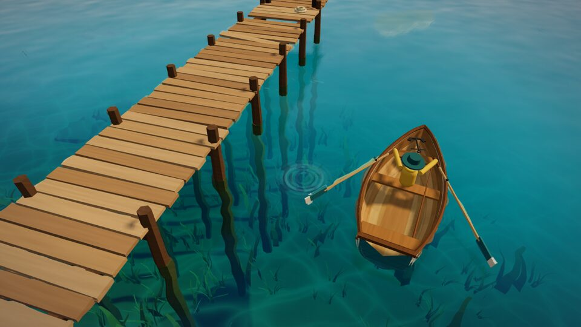 | 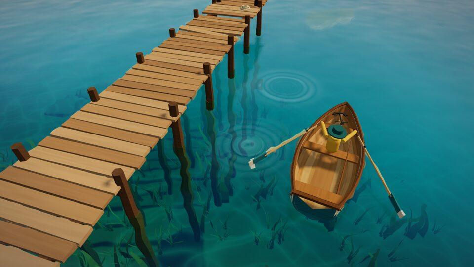 |
  | 9 s | 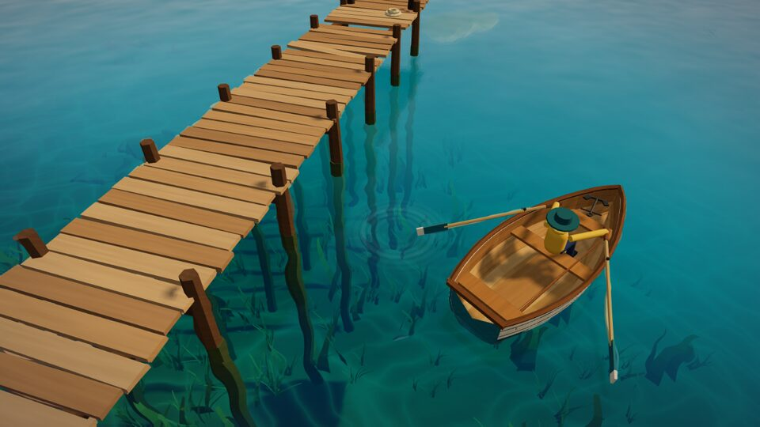 | 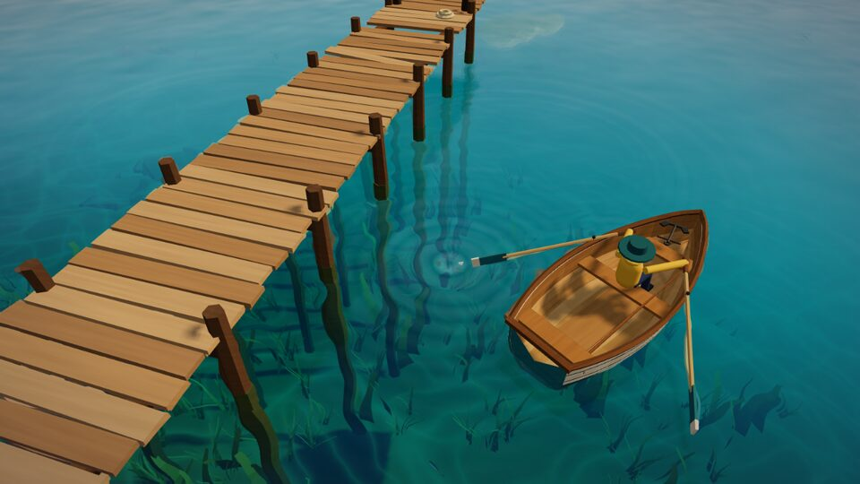 |

  **What it costs.** While there are rings about (it stops a minute after the last): a pass for
  the walls (262,144 cells, each reading the map and testing the piers and hulls in the square, up
  to 16 and 12), a step for each 1/60 s of game time (each cell reading its eight neighbours), a
  pass to add new rings when there are any, and the square drawn into the ripple field. Not
  measured on real hardware.

- **B3 (second part):** the planing trim, checked against Savitsky. Running fast, the planing
  boats ran a degree or two flatter than a real planing hull of their weight, beam, deadrise and
  centre of gravity does by Savitsky's equations (1964, the ones the ITTC's planing procedure
  uses): the RIB at 1.0° at 16 m/s where they give 2.9°, the jet ski at 1.6° at 14 m/s where they
  give 3.6°. Three things in the panels' physics held them down:

  - **Too much lift for the bottom wet.** The panels press back on a bottom running into the
    water by ½·ρ·1.1·u² for each unit of its angle: about twice what Savitsky's lift gives a
    planing bottom for its wetted area and trim (his C_L about 0.54 for each radian, against the
    panels' 1.1). So a hull rode high on about half her real wetted length (the RIB on 0.9 beams
    of it at 16 m/s, with her lift moved forward but not yet less; Savitsky's 2.0), flat. On the
    plane (from a speed coefficient V/√(g·b) of 1.5, all of it by 3) the bottom's pressure from
    running forward is now half the panels' own (PLANE_LIFT); what it meets heaving and pitching
    through the water is as before, so her motions are as damped (with that halved too, the jet
    ski bounced 8 cm on flat water).
  - **Its lift in the wrong place.** The water's pressure on a planing bottom peaks where the
    spray leaves it, forward, and falls to nothing at the transom; the panels' is even along it.
    So her lift is moved forward to where Savitsky puts it, 0.75 − 1/(5.21·Cv²/λ² + 2.39) of her
    wetted length from the transom, by the difference from its middle, as a couple: how much she's
    lifted, and how that shifts as she pitches, are as the panels have it; only its steady place
    moves. It follows her steady running: her wetted length smoothed over half a second, the lift
    taken as her weight (following each slap of her bow set the jet ski porpoising, ±5°), and it
    goes as what holds her up falls from 90% of her weight to half of it (leaving the water off a
    crest, only her transom in it, it stood the RIB on her tail in a rough sea, 43°).
  - **Her propeller and her resistance out of balance.** The game's propeller pushes harder than a
    real one (it makes up for the resistance the game gives her), so its turning arm was scaled to
    a real one's (PROP_LEVER, against wheelies); but her resistance still acted low on her hull,
    at its full depth, holding her bow down more than the propeller lifted it. On the plane it now
    acts at the same scaled height, so the two balance about her centre of gravity, as Savitsky
    takes them; and, as the shift above, back at its depth as she leaves the water (kept there,
    off a crest it no longer helped put her bow down, and the RIB reared to 27° in a rough sea).

  Measured in calm water, steady over ten seconds at each lever (her bottom's angle to the water;
  hydro.js savitskyTrim for hers):

  | | Speed | Before | Now | Savitsky |
  | --- | --- | --- | --- | --- |
  | RIB | 14.4 m/s | 1.1° | 2.3° | 3.2° |
  | RIB | 15.9 m/s | 1.0° | 2.5° | 2.9° |
  | RIB | 17.4 m/s | 0.8° | 2.4° | 2.7° |
  | Jet ski | 12.7 m/s | 1.8° | 4.2° | 4.0° |
  | Jet ski | 14.1 m/s | 1.6° | 3.1° | 3.6° |
  | Jet ski | 15.1 m/s | 1.3° | 3.3° | 3.2° |

  Steady: her pitch wanders by at most about 0.4° (standard deviation) at any of these. (The speeds
  before were the same to 0.3 m/s.) Slower, at 12 m/s, the RIB is still 1.4° under Savitsky's
  3.8°; and the console and the bass boat, which run below a speed coefficient of 3, getting onto
  the plane rather than fully on it, where his equations are at their edge, came up less (the
  console 0.6 to 2°, the bass boat 0 to 0.7°) and are still 1.4 to 2.8° under them. Their speeds are as before to a percent or two
  (tools/engine-trials.mjs measured them again: the figures the Marine Works shows).

  In the tests' rough sea, flat out, the RIB's bow now lifts to 14° at most (it was 9°), against
  the test's limit of 23° (she stood on her tail at 54°, once), and she's off the water for 1.3 s
  of the 25 (it was 0.7): she comes off a crest a little more freely, as a planing hull at her real
  trim does.
